<div align="center">


# Office Crew（오피스 크루）

**いつも使っている AI CLI をひとつのチームにまとめ、働く様子をアイソメトリックなオフィスでリアルタイムに見守れます。**

[English](README.md) · [한국어](README.ko.md) · [简体中文](README.zh-CN.md) · 日本語

[](LICENSE)
[](https://nodejs.org)
[](package.json)
[](CONTRIBUTING.md)
[](#-よくある質問)

</div>

<p align="center">
  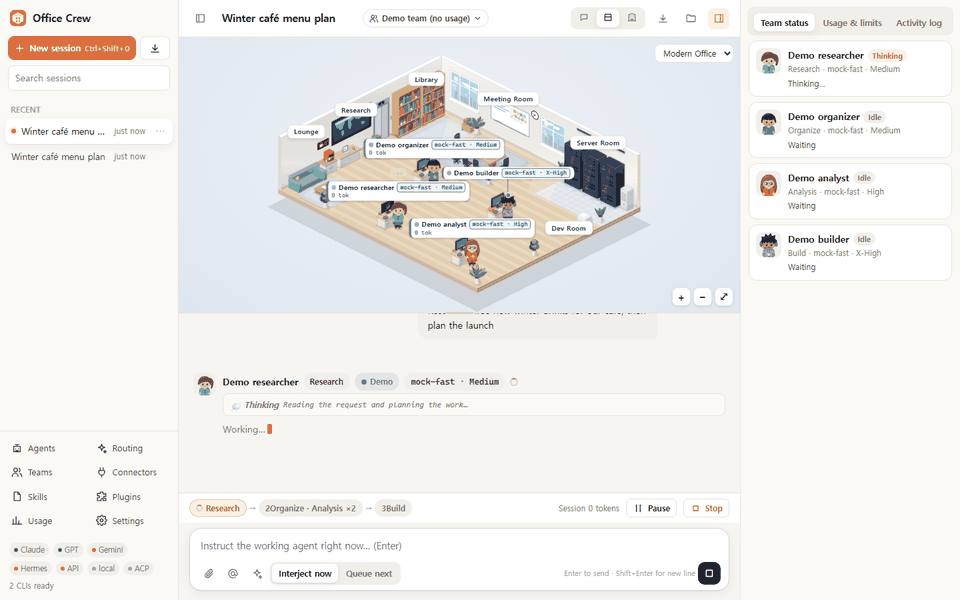
</p>

Office Crew は、複数の AI エージェントをまとめて動かすためのローカルなワークスペースです。**インストールしてサインイン済みの公式 CLI**（Claude Code、OpenAI Codex CLI、Gemini CLI、Nous Hermes Agent）と ACP 対応エージェントをそのまま実行し、OpenAI 互換 API やローカルモデルも併用できます。エージェントを段階ごとに配置すれば、作業中の各エージェントがオフィスを行き来する様子を見ながら、いつでも介入できます。

## 💡 Office Crew を選ぶ理由

- **契約中のサブスクリプションをそのまま使えます。** Office Crew は手元の PC で公式 CLI を既存のサインイン状態のまま起動します。パスワードを尋ねたり保存したりすることはありません。
- **チャット欄ひとつではなく、チームで動きます。** エージェントごとにモデル、推論の深さ（effort）、権限、スキル、MCP コネクタを設定できます。段階は順番に、同じ段階のエージェントは並列で実行され、自動ルーティングでは、レビューを可能な限りビルド担当とは別の AI がクロスチェックします。
- **すべてのステップを見て、調整できます。** エージェントはクルー村に住んでいます。休んでいる間は家にいて、仕事が始まると会社へ出勤し、使うツールに応じて図書館・展望台・作業場・広場へ歩いていきます。承認が必要なら手を挙げ、エラーが起きると冷や汗をかきます。実行中でもエージェントへの指示を変えたり 1 人だけスキップしたりでき、次の段階の前に一時停止したり、実行全体を止めたりできます。
- **軽量です。** ランタイム依存ゼロ、ビルド不要、待機時のメモリは約 65 MB。サーバーは `127.0.0.1` でのみ待ち受けます。

## ✨ 機能

### エージェントと自動ルーティング

- **エージェントごとのルーティング：** AI（プロバイダー）・モデル・推論の深さ（各 CLI と同じ段階：低・中・高・超高・最大、対応する Codex モデルはウルトラまで）・権限（読み取り専用 → すべて許可）・役割の指示（システムプロンプト）・スキル・MCP コネクタ・アバター（人・オリジナルのクリーチャー・自分の画像）をエージェントごとに設定します。
- **CLI と同じモデル一覧：** Claude は Claude Code と同じようにバージョンで表示します（例：Opus 5.5、Fable 5.2、Sonnet 5.5、Haiku 5.5）。エイリアスは常に最新モデルにつながり、実行で実際に使われたバージョンを覚えます。Codex は自身のモデル一覧にあるモデルを、前世代まで Codex と同じ順番ですべて表示します。CLI で使っている既定のモデル・推論の深さには印が付き、30 分ごとと CLI の更新を検知したときに自動で更新されます。自動ルーティングは前世代のモデルを選びません。
- **自動ルーティング（新規エージェントの既定）：** 実行開始時に、自動割り当ての対象となるサインイン中の AI（Claude Code、Codex、OpenAI 互換 API、ローカルモデル、調査役には Gemini CLI も）からモデルと推論の深さを選びます。判断基準は役割（調査・整理・分析・ビルド・レビュー・執筆）とプロファイル（エコノミー・バランス・ベスト）です。レビュー担当は、可能な限りビルド担当とは別の AI に割り当てます。
- **ルーティングボード：** すべてのエージェントの AI、モデル、推論の深さ、権限をひとつの表で編集できます。

| エージェント編集 | AI アカウントとサインイン |
|---|---|
| 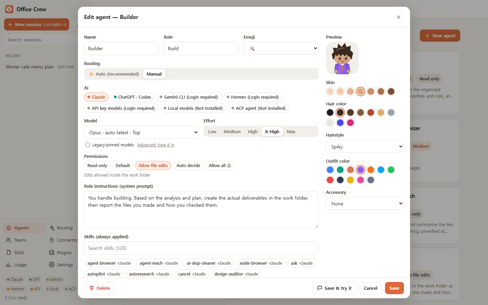 | 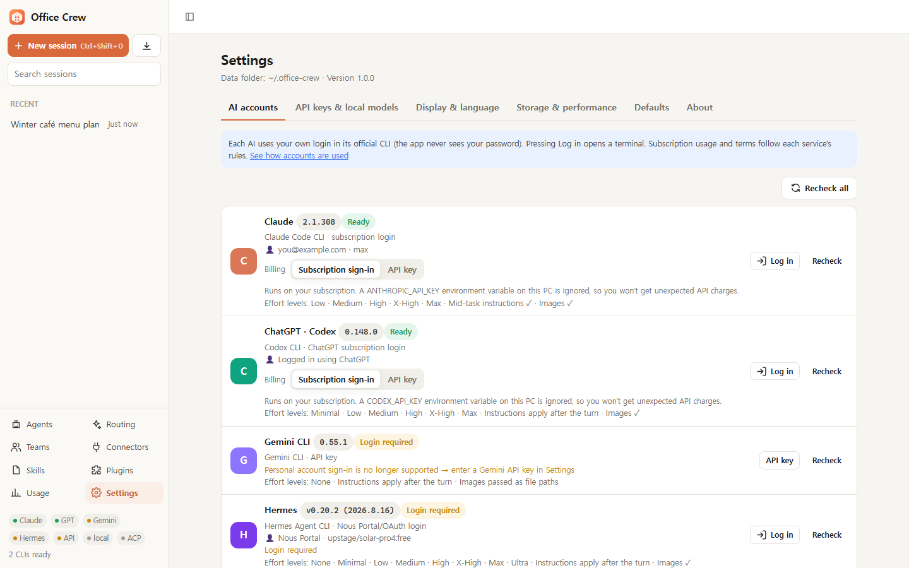 |
| エージェントごとのプロバイダー、モデル、推論の深さ、権限、スキル、アバター | CLI ごとのバージョン、サインイン状態、対応する推論の深さ |

### チーム、承認、リアルタイム介入

- **パイプライン：** 段階は順番に実行され、同じ段階のエージェントは並列で動き、各段階の出力は自動で次の段階に引き継がれます。
- **承認ゲート：** 段階の終わりで承認を待たせることができます。承認するか、修正を依頼すればフィードバックを添えて同じ段階を再実行します。
- **エラーゲート：** エージェントが失敗したら、再試行・スキップ・停止から選べます。
- **作業中の介入：** 実行中のエージェントへ指示を送る（Claude は実行中のプロセスに直接注入）、次のターンにメッセージを予約する、一時停止と再開、停止、特定のエージェントだけスキップ、といった操作ができます。
- **リアルタイムの使用量：** メッセージ・エージェント・セッションごとのトークン数（ストリーミング中は推定値、ターン終了時に実測値）、CLI が報告する場合はコスト、アカウントの利用上限（Claude の 5 時間・週間 %、Codex の週間 %）を表示します。
- **対応待ち：** サイドバーの一番上に、あなたを待っているセッション（承認、エラー後の判断、一時停止、失敗、まだ開いていない結果）をまとめて表示します。クリックするとそのセッションへ直接移動します。結果と失敗は開くと一覧から消え、承認・判断・一時停止は対応するまで残ります。
- **証拠にもとづくレビュー：** レビュー担当のエージェントには、自分で確認した証拠（ファイル、コマンドやテストの出力）だけで判定し、確認できなかった項目は別に書くよう指示します。結果を作ったのと同じ AI がレビューすると、クロスチェックより弱いことを示す表示が付きます。

| チーム編集 | 承認ゲート |
|---|---|
| 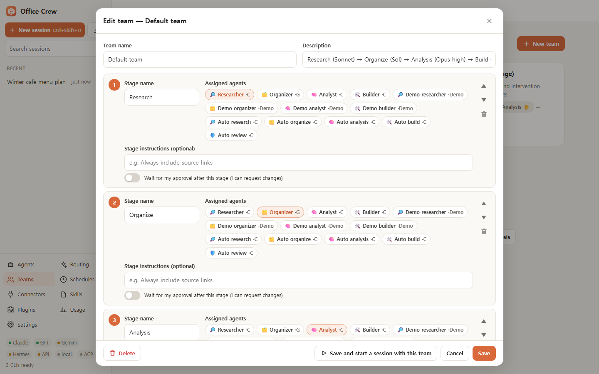 | 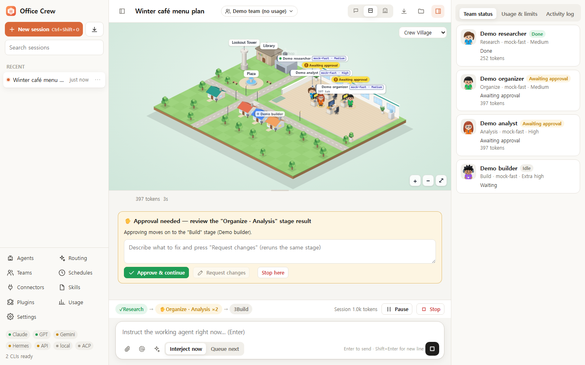 |
| 段階、担当エージェント、段階ごとの指示、承認スイッチ | 承認して続行 / 修正を依頼 / ここで停止 |

### 止まらない、もっとつながる

- **自動引き継ぎ：** 作業中にある AI が使用量の上限に達すると、余裕のある別の AI が同じ役割で引き継ぎ、止まったところから仕上げます。元のリクエスト、ここまでに書かれた内容、そしてサーバーがツールの記録から取り出した引き継ぎメモ（使ったツール、変更したファイル、最後のコマンド。コマンドはプログラム名・よく知られたサブコマンド・普通のファイル名だけを残し、トークンやパスワードが入りやすいその他の引数は省きます）をまとめて受け取り、まず現在の状態を確認するよう指示されます。上限に達した CLI（Claude Code、Codex、Gemini CLI、Hermes）は、使用量データのリセット時刻まで休みます。そのデータがなければエラーメッセージに書かれた時刻まで休みます（どちらもなければ 30 分）。休止中の AI や、使用率が基準（既定 95%）を超えた AI は実行前に避けます。ルーティング画面でオフにしたり、基準を変えたり、休止中の AI をすぐに戻したりできます。
- **AI ごとの課金方式：** Claude Code と Codex を、ご自身のサブスクリプションで使うか、公式 API キー（従量課金）で使うかを選べます。サブスクリプションモードでは PC にある `ANTHROPIC_API_KEY`・`ANTHROPIC_AUTH_TOKEN`（Claude）・`CODEX_API_KEY` 環境変数を無視するので、思わぬ課金を防げます。API キーモードでアプリにキーを入れていない場合は、PC の環境変数のキーやゲートウェイトークンをそのまま使います。
- **ChatGPT アカウントを複数：** 設定 → AI アカウントで ChatGPT アカウントを追加できます。アカウントごとに別の Codex フォルダーでログインし、使用量の上限もそれぞれ別の AI として動きます。1 つのアカウントが上限に達すると、自動引き継ぎが次のアカウントに回します。
- **ACP エージェント：** [Agent Client Protocol](https://agentclientprotocol.com) に対応したエージェント（Gemini CLI、Hermes、OpenCode、Goose、Qwen Code など）をそのまま接続できます。ツールの権限リクエストにはエージェントの権限レベルに合わせて自動で応答します。エージェントが Office Crew に頼むファイルの読み書きは作業フォルダー内に限り（読み取りは添付フォルダーも）、エージェント自身のツールはそのエージェントのサンドボックスと権限レベルに従います。

| 自動引き継ぎ付きのルーティングボード | Claude Code・Codex のセッションを読み込む |
|---|---|
| 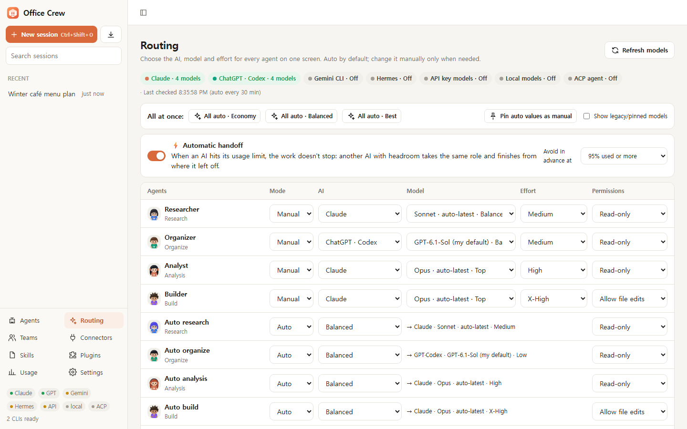 | 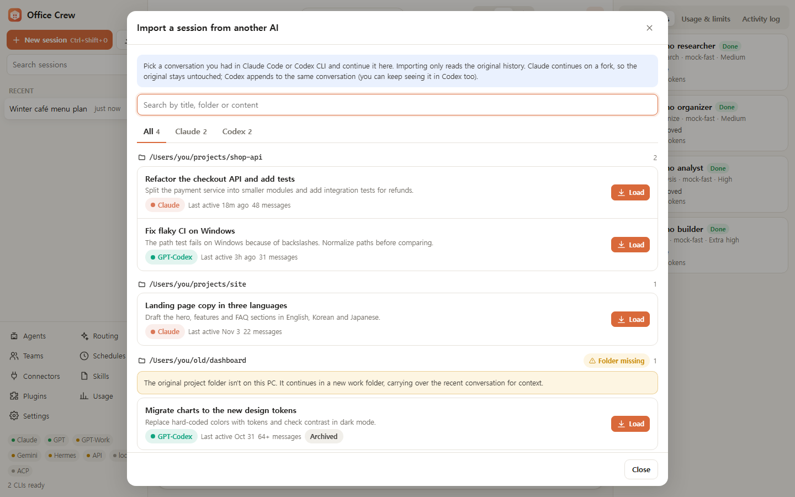 |
| エージェントごとに自動・手動を選択、上限に達したら引き継ぎ | 過去の会話を選んでそのまま続ける |

### 予約タスク

- 決めた曜日・時刻になると、チーム（またはエージェント 1 人）が同じ指示を受けて自分で仕事を始めます。結果は毎回新しいセッションに残すことも、1 つのセッションに続けて積み上げることもできます。時刻はこの PC の時計に従い、アプリが開いているときに動きます。
- アプリが閉じていて見逃した回は既定でスキップし、オンにするとアプリを開いたときに 1 回だけ実行します。前回の実行がまだ終わっていなければ、その回はスキップします。承認ステップは「待っていること」で待ちます。

| 予約タスク | スキル |
|---|---|
| 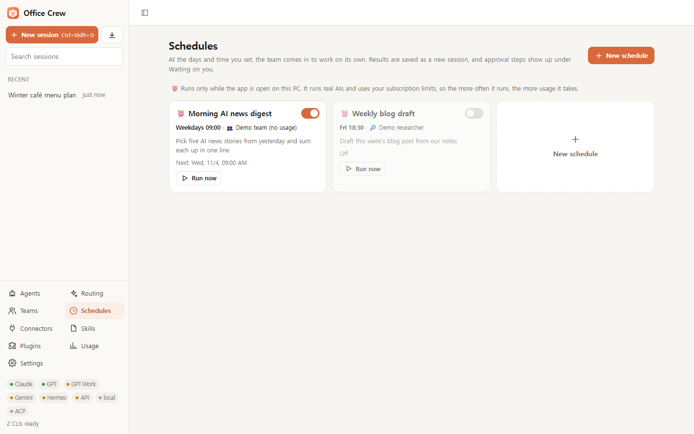 | 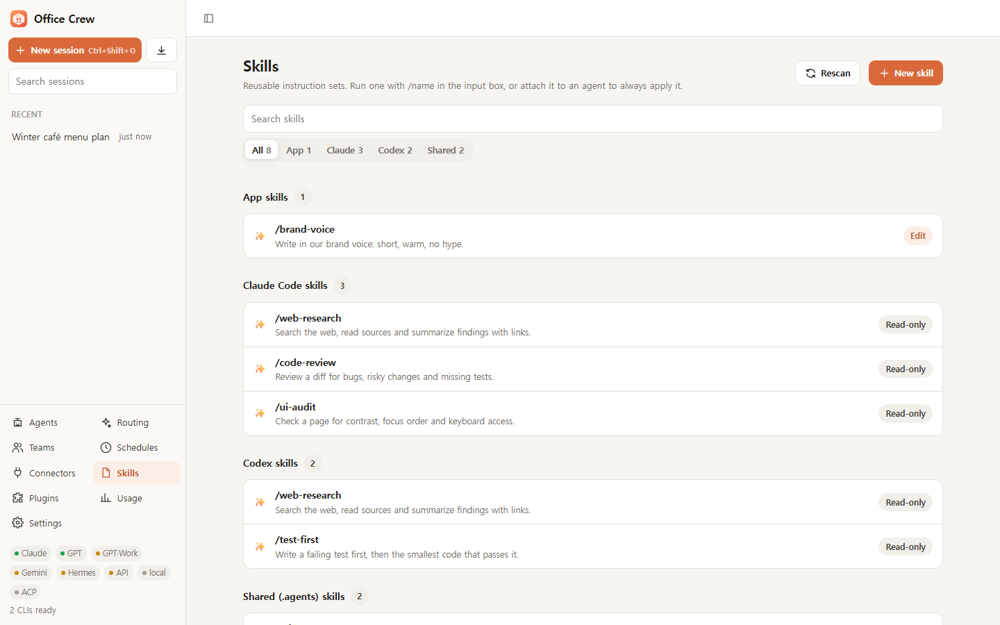 |
| 曜日・時刻・任せるチームやエージェント、今すぐ実行、オン/オフ | Claude・Codex・共用のスキルを 1 つの一覧で、出どころ別に |

### リアルタイムのオフィス：クルー村

- ゲームエンジンを使わず SVG だけで描いたアイソメトリックの村です。エージェントごとに家が 1 軒あります。休んでいるエージェントは家の中にいて（窓に明かりがつく）、仕事が始まると**会社**へ出勤し、終わると家に帰ります。使うツールに応じて、読むときは**図書館**、検索は**展望台**、コマンド実行は**作業場**、計画や長い思考は**広場**の噴水へ向かいます。
- 承認が必要なら手を挙げ、エラーが起きると冷や汗をかき、次の段階へ渡すときは書類を持って歩き、エージェントが仕事を分けるとサブエージェントのヘルパーが現れます。
- **自分好みに：** エージェントごとに人・オリジナルのクリーチャー・自分の画像から見た目を選べ（小さなドット絵もくっきり）、家も自分の画像に替えられます。画像はこの PC だけに保存されます。オフィスのスキン（モダン・コージー・ナイト）や自分の間取り画像で作ったスキンも引き続き使えます。
- **画質レベル：** 低スペックの PC 向けに `full`・`lite`・`static` を用意しています。

| ひと目でわかる状態 | 結果の受け渡し |
|---|---|
| 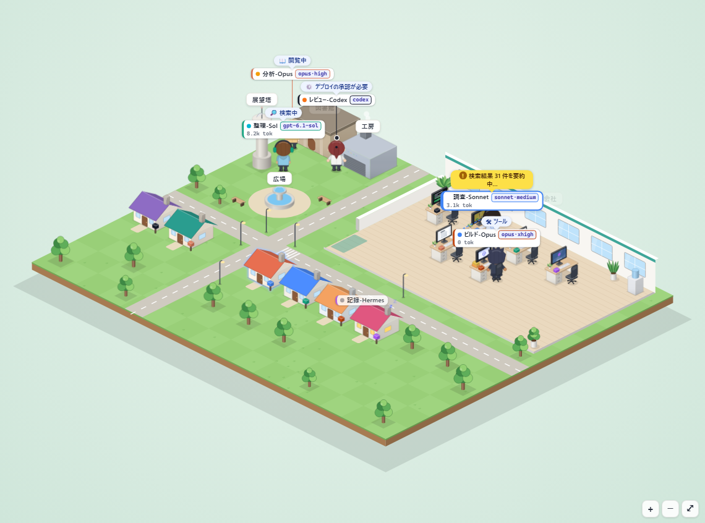 | 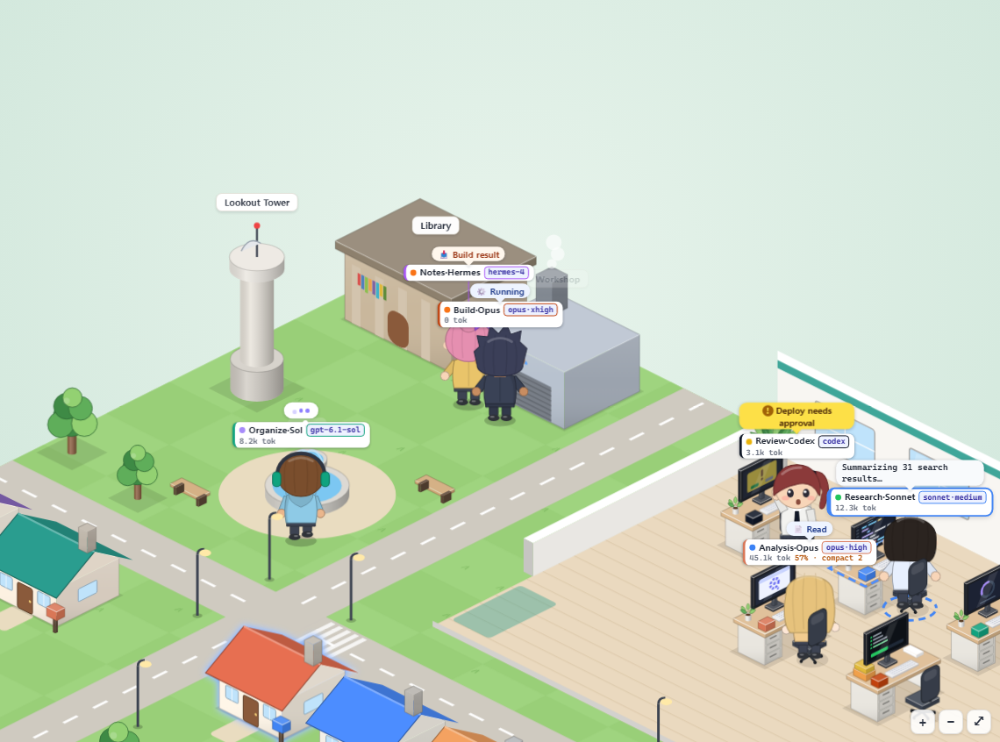 |
| 読み込み中、検索中、ツール使用、承認待ち | エージェントが結果を持って次の段階へ歩いていきます |
| **自分で飾った村** | **スキンを選ぶ** |
| 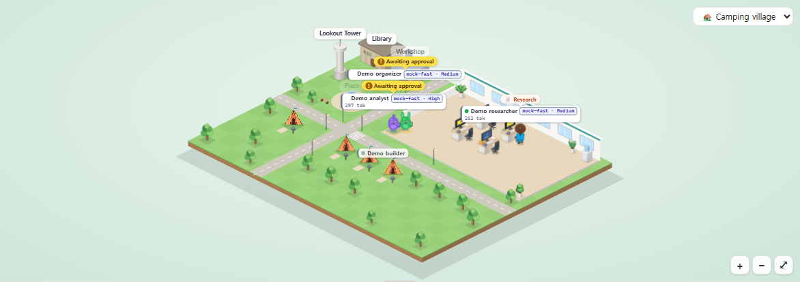 | 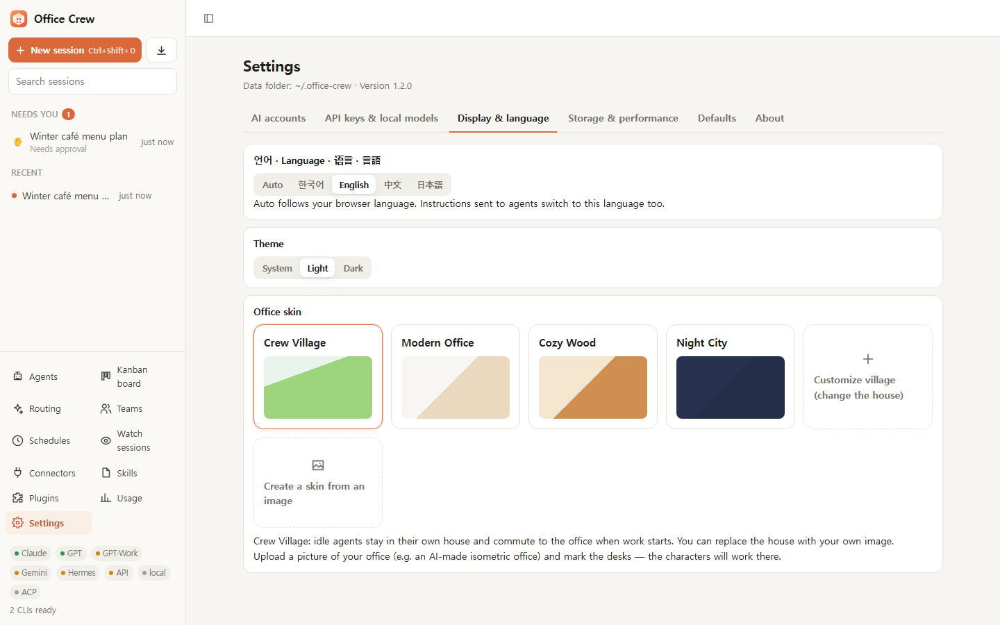 |
| テントを家に、エージェント 2 人をクリーチャーに | クルー村、オフィスのスキン、自分の画像 |

### デスクトップアプリのような使い心地

- セッションの検索とピン留め、画像の貼り付け（Ctrl+V）、ドラッグ＆ドロップ、`@エージェント` メンション、`/スキル` コマンド。
- コピーボタン付きの Markdown、再送信と編集、会話の `.md` エクスポート、ダークモード。
- **スキル**は Claude・Codex・共用（`~/.agents`）のスキルフォルダーから自動で見つけ、出どころ別に分けて表示します。韓国語の画面では説明を韓国語で表示します（この PC だけに保存、新しく入れたスキルは選んだエージェントが翻訳）。エージェントのスキルを選ぶときは「役割のおすすめ」「その AI の CLI のスキル」「選択中」「すべて」のタブで見られ、複数の場所に入っている同じスキルは 1 つにまとめて表示します。**MCP コネクタ**はエージェントごとに注入されます。**プラグイン**はエージェント・チーム・スキル・コネクタ・スキンを 1 つの JSON ファイルにまとめて読み込み・書き出しできます。
- 既存の Claude Code と Codex のセッションを**取り込んで、文脈を失わずに続き**から作業できます。Claude は分岐（フォーク）で続けるので元の記録はそのまま残り、再開できないセッションは最近の会話を渡して文脈をつなぎます。
- 画面の言語：韓国語、英語、簡体字中国語、日本語。

| ダークモード | ストリーミング中のリアルタイム使用量 |
|---|---|
| 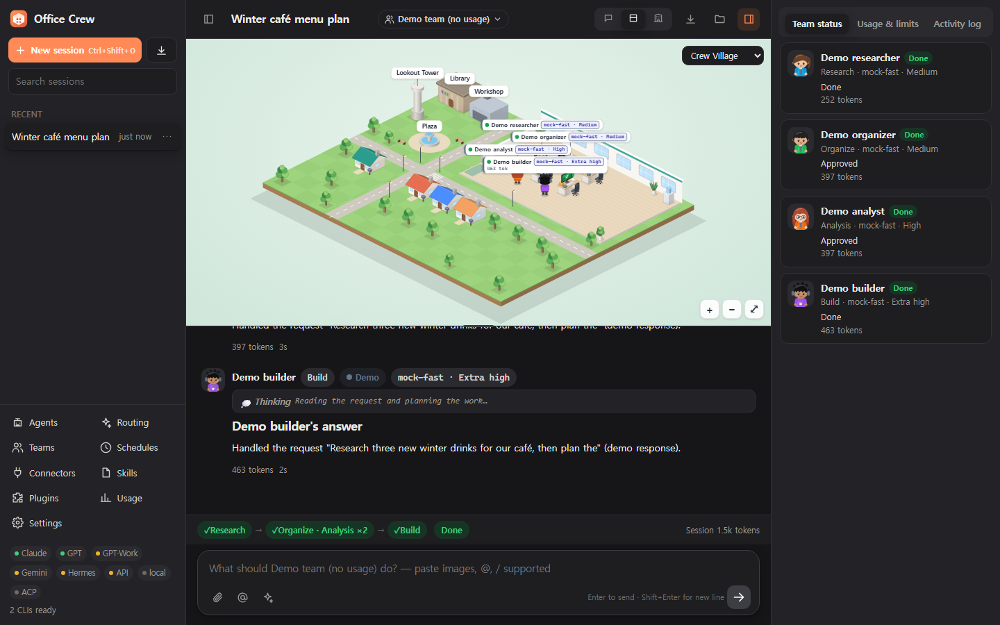 | 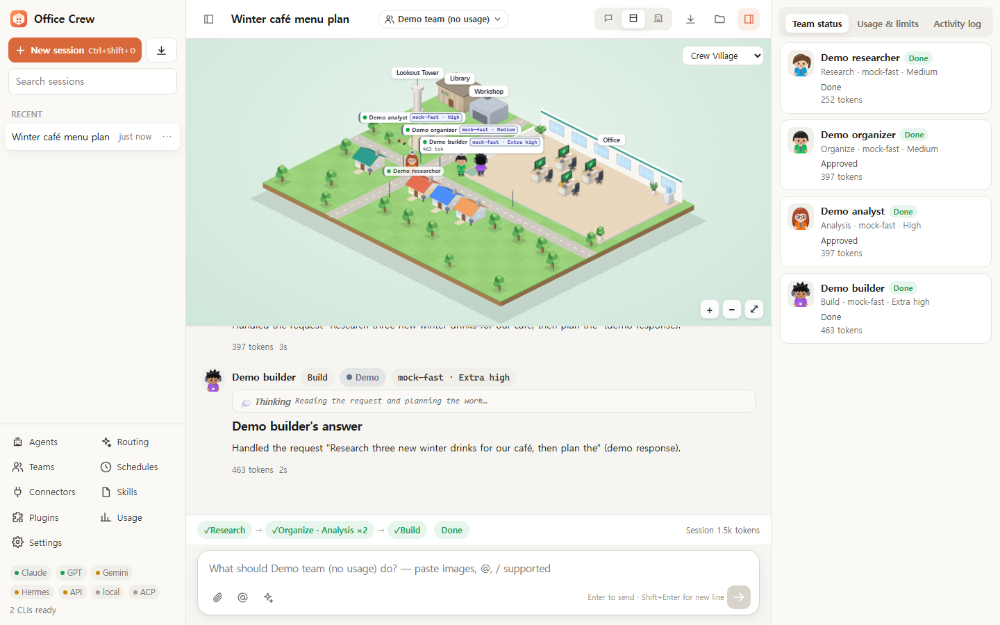 |
| コピーできるコードブロック付きのダークモード | ストリーミング中はトークンを推定し、ターン終了時に実測値へ置き換えます |

## 🚀 クイックスタート

**必要なもの：** [Node.js](https://nodejs.org) 20 以上と、使いたい AI CLI。デモを試すだけなら CLI は不要です。

```bash
git clone https://github.com/yw8837/office-crew.git
cd office-crew
npm start
```

- サーバーが `http://127.0.0.1:4317` で起動し、Edge/Chrome のアプリウィンドウが開きます。どちらも見つからない場合は既定のブラウザで開きます。
- **Windows：** `오피스크루 실행.cmd`（「Office Crew を起動」）をダブルクリックしても起動できます。`오피스크루 실행 (창 없이).vbs` を使うと黒いコンソール画面を出さずに起動します。終了するときは 設定 → 情報 → Office Crew を終了 を押してください。
- **初回起動時：** 内蔵の**デモ**チームが既定で選ばれています。デモのエージェントは模擬なので AI の利用枠を消費せず、AI を接続する前にオフィス、承認、介入の機能を試せます。
- データは `~/.office-crew` に保存されます。

| オプション | 説明 |
|---|---|
| `--browser` | アプリウィンドウの代わりに通常のブラウザタブで開く |
| `--port <n>` | サーバーのポート（既定 `4317`） |
| `--home <dir>` | データフォルダ（既定 `~/.office-crew`） |
| `--no-open` | ウィンドウを開かずにサーバーだけ起動する |

オプションは `--` の後ろに付けます。例：`npm start -- --browser --port 5000`。環境変数 `OFFICE_CREW_PORT`（または `PORT`）と `OFFICE_CREW_HOME` でも既定値を変えられます

> `npx office-crew` は近日対応予定です。まだ npm には公開していません。

## 🤖 対応している AI

| AI | 接続方法 | インストール | サインイン |
|---|---|---|---|
| **Claude Code** | 公式 CLI、ご自身のサブスクリプションまたは Anthropic API キー | `npm i -g @anthropic-ai/claude-code` | 設定 → AI アカウント → **ログイン**（ターミナルが開いたら `/login` を入力） |
| **OpenAI Codex CLI** | 公式 CLI、ご自身の ChatGPT アカウントまたは OpenAI API キー | Codex CLI | `codex login` |
| **Gemini CLI** | 公式 CLI + Gemini API キー | `npm i -g @google/gemini-cli` | 設定 → API キー・ローカルモデル → Gemini CLI のキー |
| **Nous Hermes Agent** | 公式 CLI | Hermes Agent | `hermes model` |
| **ACP エージェント** | Agent Client Protocol（stdio） | Gemini CLI、Hermes、OpenCode、Goose、Qwen Code など | 設定 → API キー・ローカルモデル → ACP エージェント（プリセットボタン） |
| **OpenAI 互換 API** | HTTPS API | 不要 | 設定 → API キー・ローカルモデル：OpenAI、OpenRouter、Nous Portal、xAI、Gemini API |
| **ローカルモデル** | 手元の HTTP サーバー | Ollama、LM Studio、llama.cpp、vLLM、Jan のいずれか | 不要。サーバーが動いていれば自動検出し、別のアドレスは設定で追加できます |
| **デモ** | 内蔵 | 不要 | 不要、使用量 0 |

設定 → **AI アカウント**で、CLI ごとのインストール状況、バージョン、サインイン中のアカウント、対応する推論の深さを確認できます。

## 🧭 仕組み

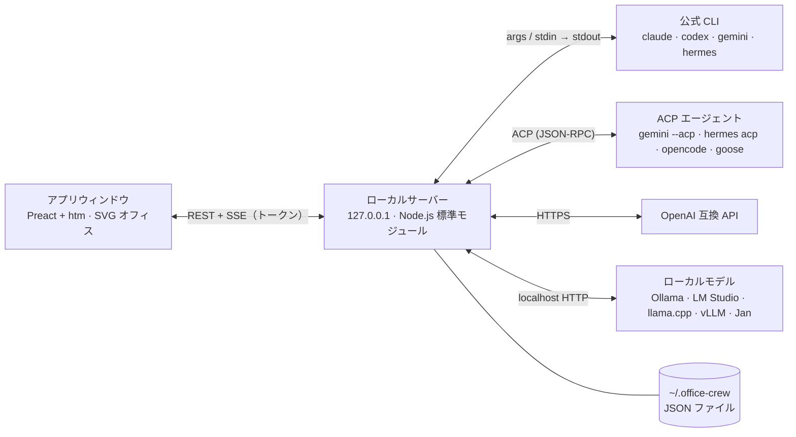

1. エージェントまたはチームにメッセージを送ります。
2. オーケストレーターが段階を進めます。各エージェントは、それぞれのモデル、推論の深さ、権限、スキル、コネクタで動く CLI プロセスまたは API 呼び出しです。
3. ストリーミング出力は Server-Sent Events（SSE）を通じて、チャットメッセージ、ツールブロック、使用量、オフィスのアニメーションに変わります。
4. 再開に対応した CLI（Claude Code、Codex）では、エージェントごとのセッション ID を保存し、次のターンも同じ会話の続きから再開します。それ以外は最近の会話をプロンプトに加えて文脈をつなぎます。

詳しい設計とプロバイダーアダプターの仕様は [docs/DESIGN.md](docs/DESIGN.md)（韓国語）にあります。

## ⚖️ 比較

特定の製品ではなく、一般的なツールの種類と比べた表です。どの種類にも優れたツールがたくさんあるので、ご自身の作業スタイルに合うものを選んでください。

| | **Office Crew** | 単一 CLI 向け GUI | ビジュアルワークフロービルダー | マルチモデルチャット UI |
|---|---|---|---|---|
| サインイン済みの公式 CLI を実行 | ✅ | CLI ひとつ | 主に API キー | 主に API キー |
| 1 回の実行で複数社の AI を併用 | ✅ | 通常は 1 社 | 対応が多い | ツールによる |
| 段階的なチーム + 並列エージェント | ✅ | まれ | 主要機能 | まれ |
| 承認ゲートと実行中の指示変更 | ✅ | ツールによる | ツールによる | 限定的 |
| エージェントごとのモデル・推論の深さ・権限 | ✅ | セッション単位 | ノード単位 | チャット単位 |
| 各エージェントの作業状況を可視化 | ✅ アニメーションのオフィス | ターミナルやログ表示 | ノードグラフ | 会話履歴 |
| ローカルモデル | ✅ | ツールによる | 対応が多い | 対応が多い |
| ランタイム依存 | 0 | ツールによる | ツールによる | ツールによる |

## 📜 アカウント利用の原則

Office Crew は、各サービスのルールの範囲内で使えるように作られています。要点は次のとおりです。

- **改変していない公式ツールだけ。** Office Crew は、インストール済みの CLI を別プロセスとして起動するだけで、ターミナルから直接実行するのと同じです。CLI を改変したり、なりすましたりしません。
- **サインイン情報は CLI のまま。** Office Crew は CLI のサインイントークン（例：`~/.claude/.credentials.json`、`~/.codex/auth.json`）を読み取ったり、コピー・保存・中継したりしません。`~/.claude.json` からは MCP サーバーの一覧だけを使います。サインインは常にターミナルウィンドウで各社の CLI を使って行います（Office Crew がウィンドウを開くこともできます）。
- **1 人、1 台の PC。** サブスクリプションでのサインインは、ご自身の PC でご自身が使うためのものです。Office Crew でアカウントを共有したり、他の人へのサービスとして提供したりしないでください。
- **製品・チーム・無人実行には API キーを。** 他の人向けの製品を作る、会社で使う、無人で動かす場合は、Claude Code と Codex の課金方式を **API キー** に切り替えてください（設定 → AI アカウント → 課金方式）。Anthropic は、承認なしにサードパーティ製品が claude.ai のサインインやサブスクリプションの上限を提供しないよう求めており、OpenAI もプログラムから Codex を使う場合は API キーを推奨しています。
- **Google：** Gemini CLI の個人向け Google サインイン（Gemini Code Assist for individuals）は使えなくなったため、Office Crew は Gemini API キーを使います。Antigravity は個人アカウントの規約上、サードパーティ製ツールからの利用が認められていないため対応していません。
- **Hermes：** Hermes のプロバイダーに Anthropic を選ぶと、Hermes が Claude Code のサインイントークンを流用することがあります。代わりに Anthropic API キーか別のプロバイダーを設定してください。
- Office Crew は Anthropic、OpenAI、Google、Nous Research とは一切関係ありません。

規約は変わることがあり、この要約は法的助言ではありません。ご利用前に各サービスの最新の規約をご確認ください。

## 🔒 セキュリティとプライバシー

- **ローカル限定。** サーバーは `127.0.0.1` にのみバインドし、`Host` や `Origin` がアプリ自身でないリクエストを拒否します（DNS リバインディングやクロスサイトからの呼び出しを防止）。すべての API 呼び出しには、インストールごとに生成されるトークンが必要です。
- **安全な描画。** エージェントの出力はエスケープしてから Markdown として描画するため、応答に含まれる HTML やスクリプトは実行されません。
- **パスワードを扱いません。** サインインは各 CLI が自分で管理します。API キーはデータフォルダ（`settings.json`）にのみ保存され、画面では末尾 4 文字だけが表示されます。コネクタや ACP の設定のうち、名前が秘密情報らしい値（token・key・secret・password など）も同じように隠します。
- **テレメトリなし。** サーバーが外部に送るリクエストは、設定した API エンドポイントとローカルモデルのサーバー宛てのものだけです。各 CLI は通常どおりそれぞれのサービスと通信します。
- **権限に注意してください。** 「すべて許可」と、Gemini CLI・ACP エージェントの「自動判断」では、エージェントが確認なしでコマンドを実行するため、信頼できるフォルダでのみ使ってください。

脆弱性を見つけた場合は [SECURITY.md](SECURITY.md) をご覧ください。

## ❓ よくある質問

**AI サービスの利用規約上、使っても問題ありませんか？**
Office Crew が代わりにサインインしたり、アカウントを中継したり、認証情報を共有したりすることはありません。ご自身でインストールしサインインした公式 CLI を、ご自身の PC 上で、ターミナルから実行するのと同じ方法で起動するだけです。自動化やサードパーティ製ツールに関する条項を含め、各サービスの規約を守る責任は利用者にあります。組織や商用での利用には API キーをおすすめします。Office Crew が守っている原則は[アカウント利用の原則](#-アカウント利用の原則)にまとめています。Office Crew は Anthropic、OpenAI、Google、Nous Research とは一切関係ありません。

**費用はかかりますか？**
Office Crew 自体は AGPL のもとで無料です。使用量は、各 CLI を直接使う場合とまったく同じく、ご自身のサブスクリプションや API キーから差し引かれます。使用量パネルでトークンとアカウントの上限をリアルタイムに確認でき、ルーティングプロファイルを**エコノミー**にすれば安価なモデルが選ばれます。デモのプロバイダーは費用がかかりません。

**オフラインやローカルモデルだけでも使えますか？**
使えます。Ollama、LM Studio、llama.cpp、vLLM、Jan は起動していれば自動で検出されます。画面で使う Preact と htm もリポジトリに同梱しているので、CDN から読み込むものはありません。

**すべての CLI をインストールする必要がありますか？**
いいえ。必要なものだけで大丈夫です。自動ルーティングはサインイン中の AI だけを対象にします。

**どの OS で動きますか？**
Office Crew は Windows で開発しており、CI では Windows、Linux、macOS（Node.js 20 と 22）でテストを実行しています。アプリウィンドウには Edge か Chrome を使い、見つからない場合は既定のブラウザで開きます。

## 🗺️ ロードマップ

- [ ] npm での公開と `npx office-crew`
- [ ] 対応プロバイダーの追加
- [ ] チームテンプレートのギャラリー
- [ ] モバイル向けコンパニオンアプリ

アイデアや投票は [Issues](https://github.com/yw8837/office-crew/issues) にお寄せください。

## 🤝 コントリビュート

バグ報告、プロバイダーアダプター、スキン、翻訳のどれも歓迎します。まずは [CONTRIBUTING.md](CONTRIBUTING.md) をお読みください。テストは偽の CLI で動くため、`npm test` で AI の利用枠を消費することはありません。

```bash
npm test
```

[行動規範](CODE_OF_CONDUCT.md)を守ってください。変更履歴は [CHANGELOG.md](CHANGELOG.md) にあります。

## 📄 ライセンス

Office Crew は**デュアルライセンス**です。

- [GNU AGPL-3.0-only](LICENSE)：個人利用、学習、研究、社内ツール、AGPL を守るオープンソース（無料）。
- **商用ライセンス**：ソースを公開しない製品、改変したソースを公開しないホスティングサービス、その他の条件が必要な場合。[COMMERCIAL-LICENSE.md](COMMERCIAL-LICENSE.md) をご覧ください。

同梱しているサードパーティのコード（Preact：MIT、htm：Apache-2.0）は [THIRD-PARTY-NOTICES.md](THIRD-PARTY-NOTICES.md) にまとめています。各製品名はそれぞれの所有者の商標です。

## ⭐ スター推移

[](https://star-history.com/#yw8837/office-crew&Date)
