<div align="center">


# 오피스 크루 (Office Crew)

**이미 쓰고 있는 AI CLI를 한 팀으로 묶고, 일하는 모습을 아이소메트릭 사무실에서 실시간으로 지켜보세요.**

[English](README.md) · 한국어 · [简体中文](README.zh-CN.md) · [日本語](README.ja.md)

[](LICENSE)
[](https://nodejs.org)
[](package.json)
[](CONTRIBUTING.md)
[](#-자주-묻는-질문)

</div>

<p align="center">
  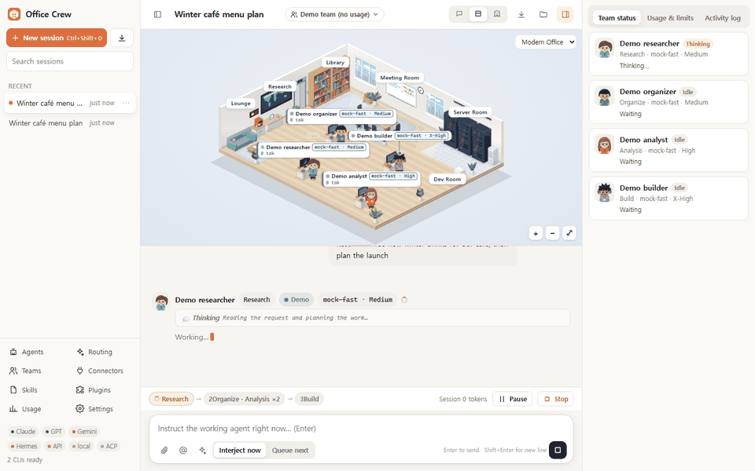
</p>

오피스 크루는 여러 AI 에이전트를 함께 돌리는 로컬 작업 공간입니다. 내 PC에 **설치하고 로그인해 둔 공식 CLI**(Claude Code, OpenAI Codex CLI, Gemini CLI, Nous Hermes Agent)와 ACP 표준 에이전트를 그대로 실행하고, OpenAI 호환 API와 로컬 모델도 함께 쓸 수 있습니다. 에이전트를 단계별로 배치해 두면, 작업하는 동안 각 에이전트가 사무실을 오가는 모습을 보면서 언제든 끼어들 수 있습니다.

## 💡 왜 오피스 크루인가

- **이미 가진 구독을 그대로 씁니다.** 오피스 크루는 내 PC의 공식 CLI를 기존 로그인 상태 그대로 실행합니다. 비밀번호를 묻거나 저장하지 않습니다.
- **채팅창 하나가 아니라 팀입니다.** 에이전트마다 모델·노력(effort)·권한·스킬·MCP 커넥터를 따로 정합니다. 단계는 순서대로, 같은 단계 안의 에이전트는 병렬로 실행되고, 자동 라우팅을 쓰면 검수는 가능한 한 빌드를 맡은 AI와 다른 AI가 교차 확인합니다.
- **모든 단계를 보고 조정할 수 있습니다.** 캐릭터는 쓰는 도구에 따라 정보검색실·자료실·서버실로 걸어가고, 승인이 필요하면 손을 들고, 오류가 나면 식은땀을 흘립니다. 실행 중에도 에이전트에게 지시를 바꾸거나 한 명만 건너뛸 수 있고, 다음 단계 전에 일시정지하거나 실행 전체를 중지할 수 있습니다.
- **가볍습니다.** 런타임 의존성 0개, 빌드 과정 없음, 대기 상태 메모리 약 65MB. 서버는 `127.0.0.1`에서만 열립니다.

## ✨ 기능

### 에이전트와 자동 라우팅

- **에이전트별 라우팅:** AI(프로바이더)·모델·노력(로우 → 맥스, 지원하는 모델은 X하이도)·권한(읽기 전용 → 전부 허용)·역할 지침(시스템 프롬프트)·스킬·MCP 커넥터·아바타를 에이전트마다 따로 설정합니다.
- **실시간 모델 목록:** 모델 드롭다운은 CLI가 제공하는 경우 그 CLI의 모델 목록을 그대로 가져옵니다. 30분마다, 그리고 CLI 업데이트가 감지되면 자동으로 새로 고칩니다.
- **자동 라우팅(새 에이전트의 기본값):** 실행이 시작되면 자동 배정 대상 AI(Claude Code, Codex, OpenAI 호환 API, 로컬 모델, 조사 역할엔 Gemini CLI도) 중 로그인된 것에서 모델과 노력을 고릅니다. 역할(조사·정리·분석·빌드·검수·글쓰기)과 프로필(경제·균형·최고)을 기준으로 정하고, 검수 에이전트는 가능하면 빌드와 다른 AI에 배정합니다.
- **라우팅 보드:** 모든 에이전트의 AI·모델·노력·권한을 표 하나에서 수정합니다.

| 에이전트 편집 | AI 계정·로그인 |
|---|---|
| 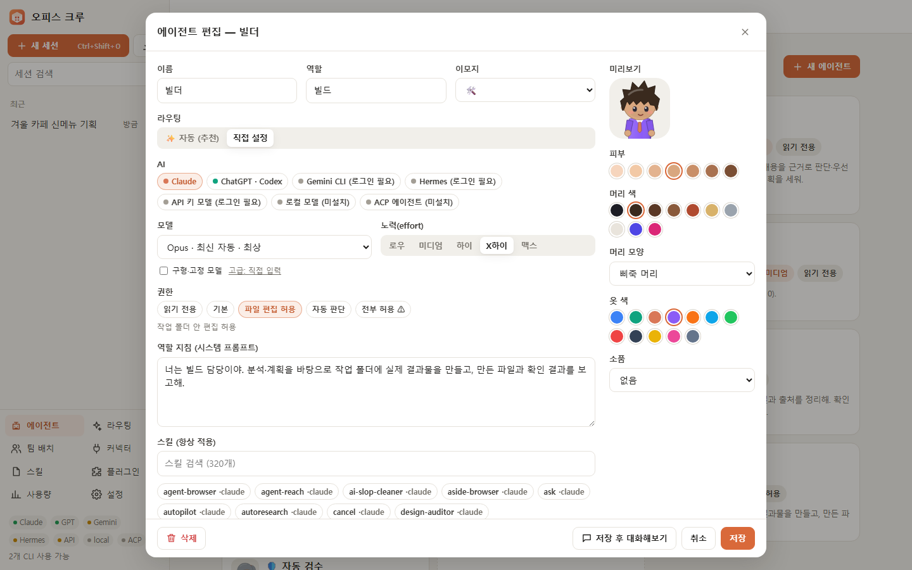 | 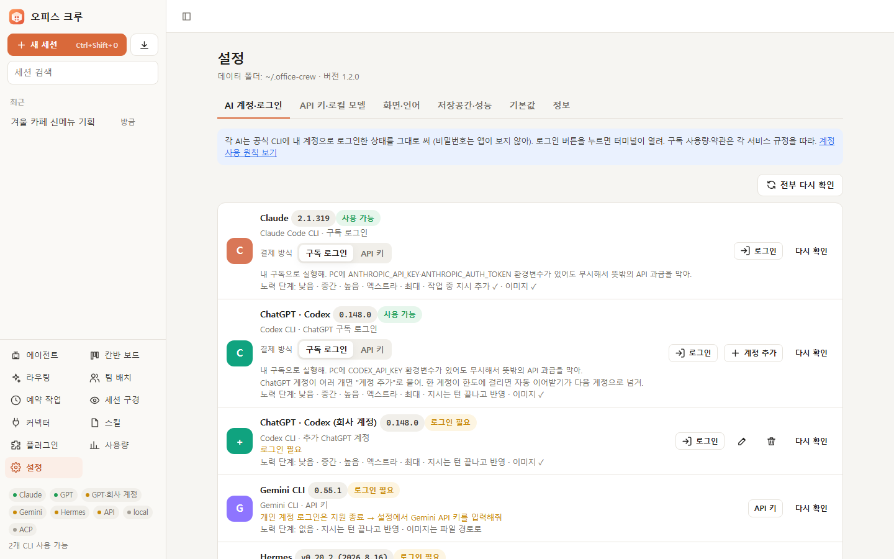 |
| 에이전트마다 AI·모델·노력·권한·스킬·아바타 설정 | CLI별 버전, 로그인 상태, 지원하는 노력 단계 |

### 팀·승인·실시간 개입

- **파이프라인:** 단계는 순서대로 실행되고, 같은 단계의 에이전트는 병렬로 일하며, 각 단계의 결과는 다음 단계로 자동 전달됩니다.
- **승인 게이트:** 단계가 끝나면 사용자의 승인을 기다리게 할 수 있습니다. 승인하거나, 수정 요청을 보내면 피드백을 붙여 같은 단계를 다시 실행합니다.
- **오류 게이트:** 에이전트가 실패하면 재시도·건너뛰기·중지 중에서 고릅니다.
- **작업 중 개입:** 실행 중인 에이전트에게 바로 지시를 보내거나(Claude는 실행 중인 프로세스에 즉시 주입), 다음 차례로 메시지를 대기열에 넣고, 일시정지·재개·중지하거나 에이전트 한 명만 건너뛸 수 있습니다.
- **실시간 사용량:** 메시지·에이전트·세션별 토큰(작성 중에는 추정치, 턴이 끝나면 실제 값), CLI가 알려 주는 경우 비용, 계정 한도(Claude 5시간·주간 %, Codex 주간 %)를 보여 줍니다.
- **기다리는 일:** 사이드바 맨 위에 사용자를 기다리는 세션(승인, 오류 뒤 결정, 일시정지, 실패, 아직 안 연 결과)을 모아 보여 줍니다. 누르면 그 세션으로 바로 갑니다.
- **증거로 하는 검수:** 검수 에이전트는 직접 확인한 증거(파일, 명령·테스트 출력)로만 판정하고, 확인 못 한 항목은 따로 적으라는 지침을 받습니다. 결과를 만든 AI가 그대로 검수하면 교차 검증보다 약하다는 표시가 붙습니다.

| 팀 편집 | 승인 게이트 |
|---|---|
| 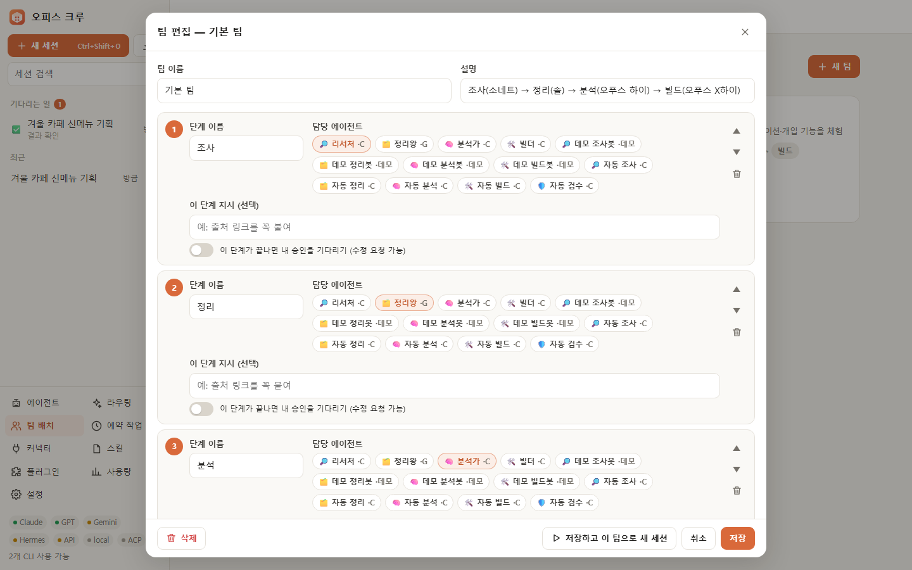 | 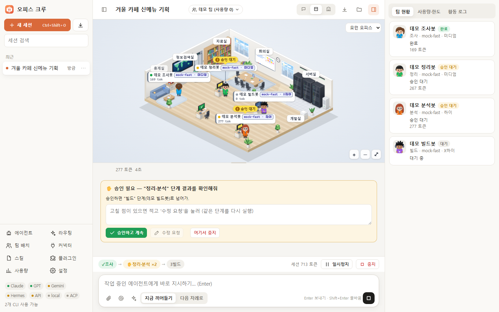 |
| 단계, 담당 에이전트, 단계별 지시, 승인 스위치 | 승인하고 계속 / 수정 요청 / 여기서 중지 |

### 멈추지 않고, 더 많이 연결

- **자동 이어받기:** 작업 중 한 AI가 사용량 한도에 걸리면, 여유 있는 다른 AI가 같은 역할로 이어받아 멈춘 곳부터 끝냅니다. 원래 요청과 지금까지 쓴 내용, 그리고 서버가 기록한 인계서(쓴 도구·손댄 파일·마지막 명령, 비밀값은 가림)를 함께 넘겨받고, 지금 상태부터 확인하라는 안내를 받습니다. 한도에 걸린 AI는 사용량 정보의 초기화 시각까지, 그 정보가 없으면 오류 문구에 적힌 시각까지 쉽니다(둘 다 없으면 30분). 쉬는 중이거나 사용률이 기준(기본 95%)을 넘은 AI는 실행 전에 미리 피합니다. 라우팅 화면에서 끄거나, 기준을 바꾸거나, 쉬는 AI를 바로 풀 수 있습니다.
- **AI별 결제 방식:** Claude Code와 Codex를 내 구독으로 쓸지, 공식 API 키(사용한 만큼 과금)로 쓸지 고릅니다. 구독 모드에서는 PC에 깔린 `ANTHROPIC_API_KEY`·`ANTHROPIC_AUTH_TOKEN`(Claude)·`CODEX_API_KEY` 환경변수를 무시해서 뜻밖의 과금을 막습니다. API 키 모드에서 앱에 키를 넣지 않으면 PC 환경변수의 키나 게이트웨이 토큰을 그대로 씁니다.
- **ACP 에이전트:** [Agent Client Protocol](https://agentclientprotocol.com)을 지원하는 에이전트(Gemini CLI, Hermes, OpenCode, Goose, Qwen Code 등)를 그대로 붙입니다. 도구 권한 요청은 에이전트의 권한 단계에 맞춰 자동으로 답합니다. 에이전트가 오피스 크루에 맡기는 파일 읽기·쓰기는 작업 폴더 안으로 제한하고(읽기는 첨부 폴더도), 에이전트 자체 도구는 그 에이전트의 샌드박스와 권한 단계를 따릅니다.

| 자동 이어받기가 있는 라우팅 보드 | Claude Code·Codex 세션 불러오기 |
|---|---|
| 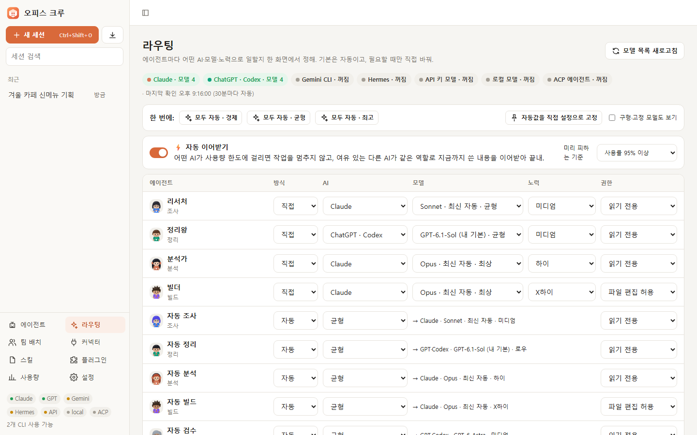 | 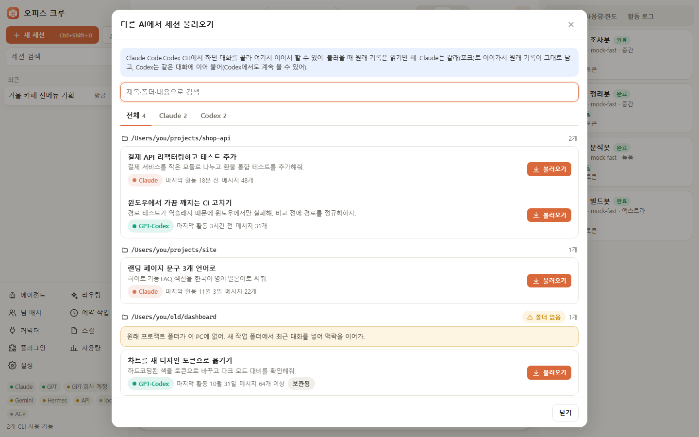 |
| 에이전트마다 자동·직접 선택, 한도에 걸리면 이어받기 | 지난 대화를 골라 그대로 이어서 작업 |

### 실시간 사무실

- 게임 엔진 없이 SVG만으로 그린 아이소메트릭 사무실입니다. 에이전트는 쓰는 도구에 따라 **정보검색실**·**자료실**·**서버실**·**회의실**로 걸어갑니다.
- 승인이 필요하면 손을 들고, 오류가 나면 식은땀을 흘리고, 다음 단계로 넘길 때는 서류를 들고 걸어가며, 에이전트가 일을 나누면 서브에이전트 도우미가 나타납니다.
- **스킨:** 모던·코지·나이트 3종을 기본 제공하고, 내 이미지를 올린 뒤 편집기에서 책상과 이동 지점을 배치해 스킨으로 쓸 수도 있습니다.
- **화질 단계:** 저사양 PC를 위해 `full`·`lite`·`static`을 지원합니다.

| 한눈에 보는 상태 | 결과 전달 |
|---|---|
| 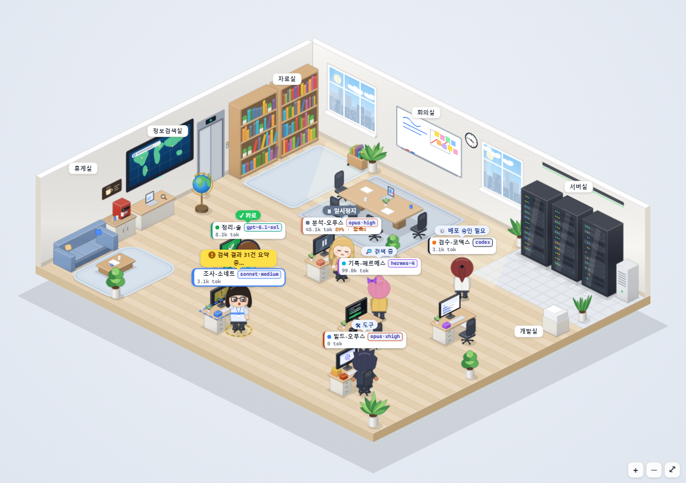 | 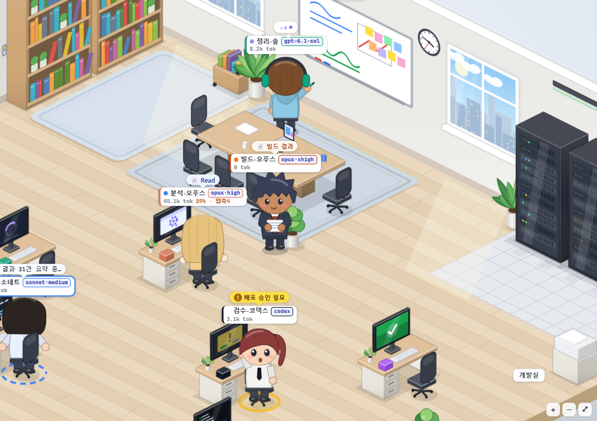 |
| 검색 중, 도구 사용, 일시정지, 완료, 승인 필요 | 에이전트가 결과를 들고 다음 단계로 걸어갑니다 |
| **모던 스킨** | **코지 스킨** |
| 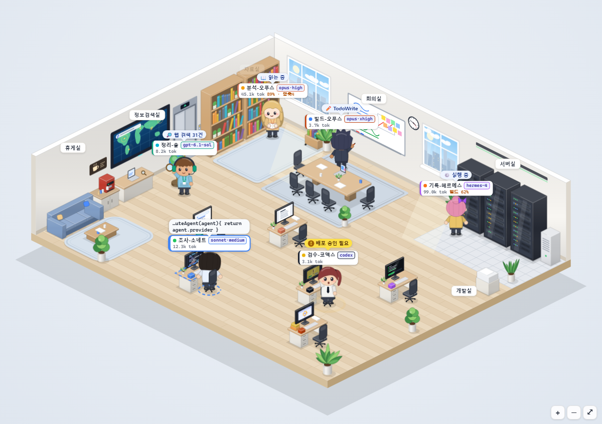 | 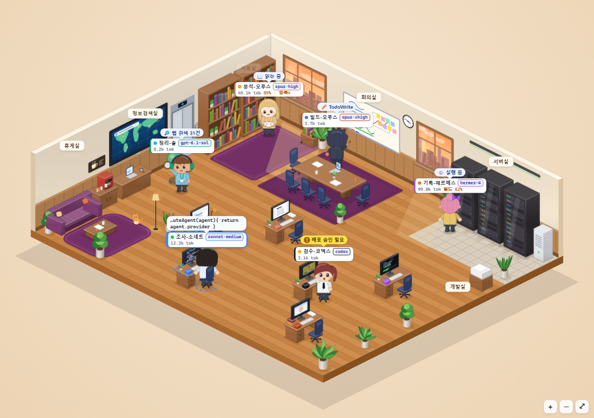 |
| **나이트 스킨** | **내 이미지로 만든 스킨** |
| 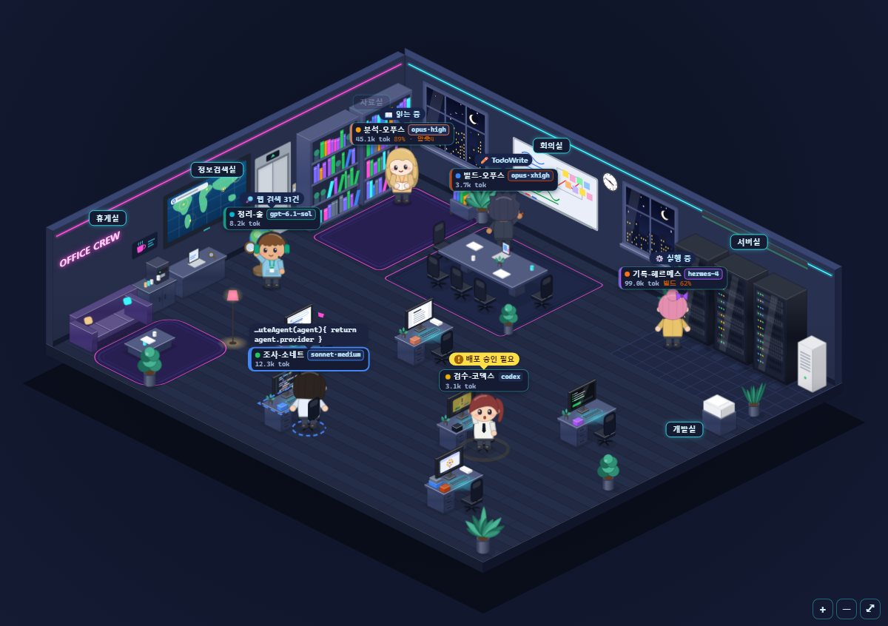 | 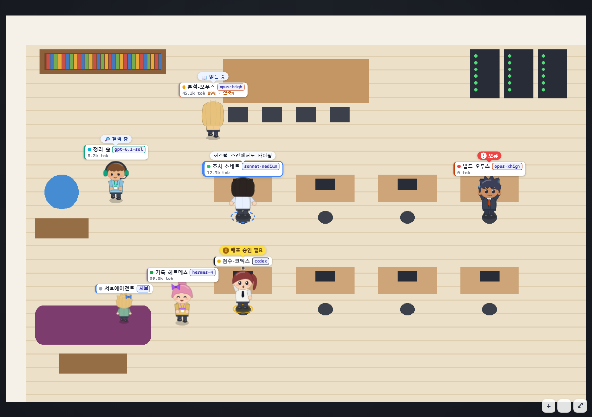 |

### 데스크톱 앱 같은 사용감

- 세션 검색·고정, 이미지 붙여넣기(Ctrl+V), 끌어놓기, `@에이전트` 멘션, `/스킬` 명령.
- 복사 버튼이 붙은 마크다운, 다시 보내기·고쳐 쓰기, 대화를 `.md`로 내보내기, 다크 모드.
- **스킬**은 Claude·Codex 스킬 폴더에서 자동으로 찾아옵니다. **MCP 커넥터**는 에이전트별로 주입됩니다. **플러그인**은 에이전트·팀·스킬·커넥터·스킨을 JSON 파일 하나로 묶어 가져오거나 내보냅니다.
- 기존 Claude Code·Codex 세션을 **가져와서 맥락 손실 없이 이어서** 작업합니다. Claude는 갈래(포크)로 이어 가서 원래 기록이 그대로 남고, 이어 갈 수 없는 세션은 최근 대화를 넘겨 맥락을 잇습니다.
- 화면 언어: 한국어, 영어, 중국어(간체), 일본어.

| 다크 모드 + 나이트 스킨 | 작성 중 실시간 사용량 |
|---|---|
| 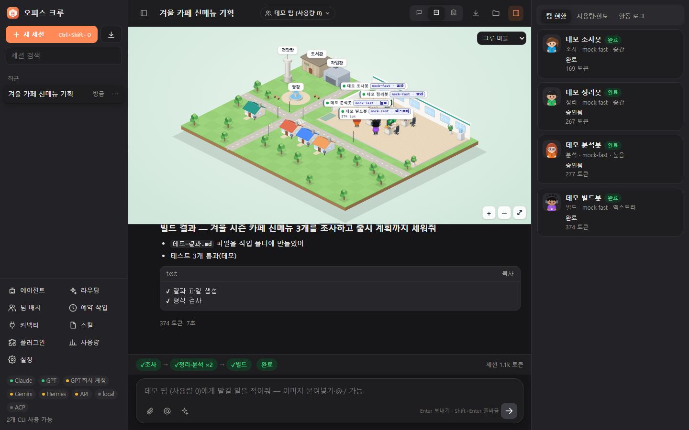 | 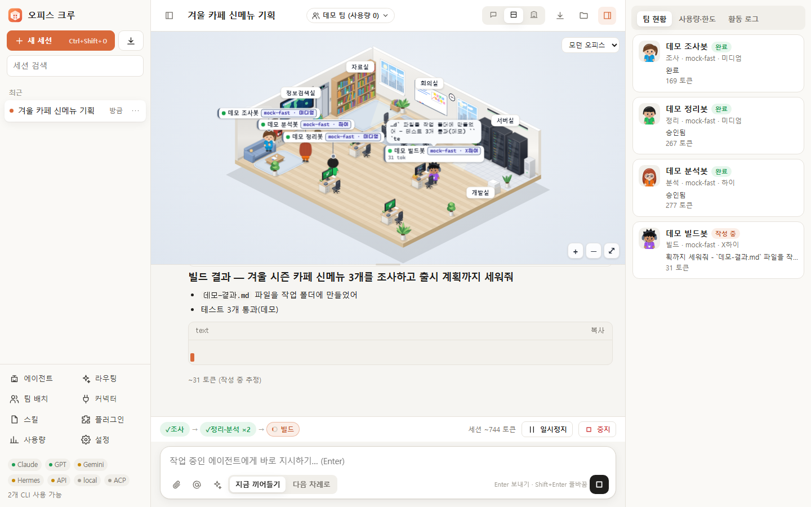 |
| 복사 가능한 코드 블록이 있는 다크 모드 | 작성 중에는 토큰을 추정하고, 턴이 끝나면 실제 값으로 바꿉니다 |

## 🚀 빠른 시작

**필요한 것:** [Node.js](https://nodejs.org) 20 이상, 그리고 쓰고 싶은 AI CLI. 데모만 써 볼 때는 CLI가 하나도 없어도 됩니다.

```bash
git clone https://github.com/yw8837/office-crew.git
cd office-crew
npm start
```

- 서버가 `http://127.0.0.1:4317`에서 시작되고 Edge/Chrome 앱 창이 열립니다. 두 브라우저가 모두 없으면 기본 브라우저로 엽니다.
- **Windows:** `오피스크루 실행.cmd`를 더블클릭해도 됩니다.
- **처음 실행할 때:** 내장 **데모** 팀이 기본으로 선택됩니다. 데모 에이전트는 가상이라 AI 사용량이 0이므로, AI를 연결하기 전에 사무실·승인·개입 기능을 먼저 체험해 볼 수 있습니다.
- 데이터는 `~/.office-crew`에 저장됩니다.

| 옵션 | 설명 |
|---|---|
| `--browser` | 앱 창 대신 일반 브라우저 탭으로 열기 |
| `--port <n>` | 서버 포트(기본값 `4317`) |
| `--home <dir>` | 데이터 폴더(기본값 `~/.office-crew`) |
| `--no-open` | 창을 열지 않고 서버만 시작 |

옵션은 `--` 뒤에 붙입니다. 예: `npm start -- --browser --port 5000`. 환경변수 `OFFICE_CREW_PORT`(또는 `PORT`)와 `OFFICE_CREW_HOME`으로도 기본값을 바꿀 수 있습니다

> `npx office-crew`는 곧 지원할 예정입니다. 아직 npm에 배포하지 않았습니다.

## 🤖 지원하는 AI

| AI | 연결 방식 | 설치 | 로그인 |
|---|---|---|---|
| **Claude Code** | 공식 CLI, 내 구독 또는 Anthropic API 키 | `npm i -g @anthropic-ai/claude-code` | 설정 → AI 계정 → **로그인**(터미널이 열리면 `/login` 입력) |
| **OpenAI Codex CLI** | 공식 CLI, 내 ChatGPT 계정 또는 OpenAI API 키 | Codex CLI | `codex login` |
| **Gemini CLI** | 공식 CLI + Gemini API 키 | `npm i -g @google/gemini-cli` | 설정 → API 키·로컬 모델 → Gemini CLI 키 |
| **Nous Hermes Agent** | 공식 CLI | Hermes Agent | `hermes model` |
| **ACP 에이전트** | Agent Client Protocol (stdio) | Gemini CLI, Hermes, OpenCode, Goose, Qwen Code 등 | 설정 → API 키·로컬 모델 → ACP 에이전트(프리셋 버튼) |
| **OpenAI 호환 API** | HTTPS API | 없음 | 설정 → API 키·로컬 모델: OpenAI, OpenRouter, Nous Portal, xAI, Gemini API |
| **로컬 모델** | 내 PC의 HTTP 서버 | Ollama, LM Studio, llama.cpp, vLLM, Jan 중 하나 | 필요 없음. 서버가 켜져 있으면 자동으로 찾고, 다른 주소는 설정에서 추가 |
| **데모** | 내장 | 없음 | 필요 없음, 사용량 0 |

설정 → **AI 계정**에서 CLI별 설치 여부·버전·로그인 계정·지원 노력 단계를 확인할 수 있습니다.

## 🧭 동작 방식

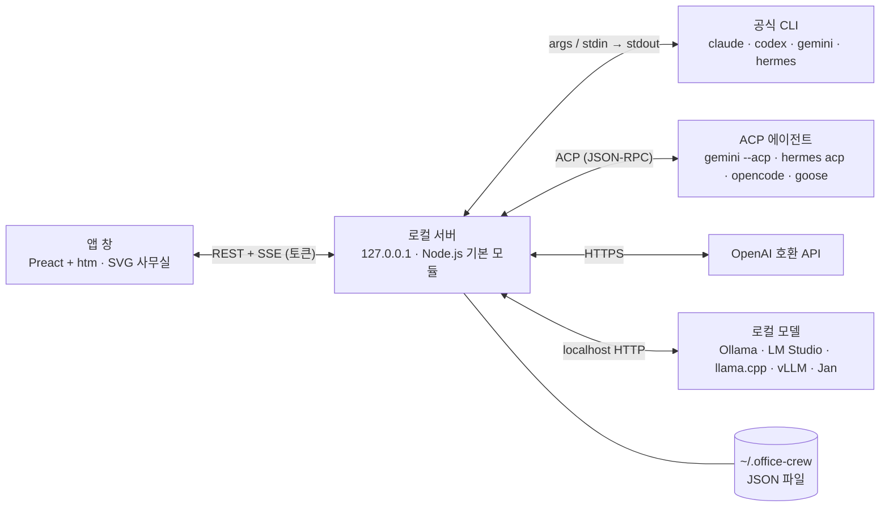

1. 에이전트 또는 팀에게 메시지를 보냅니다.
2. 실행 엔진(오케스트레이터)이 단계를 진행합니다. 각 에이전트는 자기 모델·노력·권한·스킬·커넥터로 실행되는 CLI 프로세스 또는 API 호출입니다.
3. 스트리밍 출력은 Server-Sent Events(SSE)를 통해 채팅 메시지·도구 블록·사용량·사무실 애니메이션으로 바뀝니다.
4. 이어하기를 지원하는 CLI(Claude Code, Codex)는 에이전트마다 세션 ID를 저장해 다음 턴에서 같은 대화를 이어 갑니다. 나머지는 최근 대화를 프롬프트에 넣어 맥락을 잇습니다.

자세한 설계와 프로바이더 어댑터 계약은 [docs/DESIGN.md](docs/DESIGN.md)에 있습니다.

## ⚖️ 비교

특정 제품이 아니라 일반적인 도구 유형과 비교한 표입니다. 유형마다 좋은 도구가 많으니 작업 방식에 맞는 것을 고르세요.

| | **오피스 크루** | 단일 CLI용 GUI | 시각적 워크플로 빌더 | 다중 모델 채팅 UI |
|---|---|---|---|---|
| 로그인된 공식 CLI 실행 | ✅ | CLI 하나 | 주로 API 키 | 주로 API 키 |
| 한 번의 실행에서 여러 회사 AI 혼용 | ✅ | 주로 한 회사 | 자주 지원 | 도구마다 다름 |
| 단계별 팀 + 병렬 에이전트 | ✅ | 드묾 | 핵심 기능 | 드묾 |
| 승인 게이트·실행 중 지시 | ✅ | 도구마다 다름 | 도구마다 다름 | 제한적 |
| 에이전트별 모델·노력·권한 | ✅ | 세션 단위 | 노드 단위 | 채팅 단위 |
| 각 에이전트 작업 상황 시각화 | ✅ 애니메이션 사무실 | 터미널·로그 화면 | 노드 그래프 | 대화 기록 |
| 로컬 모델 | ✅ | 도구마다 다름 | 자주 지원 | 자주 지원 |
| 런타임 의존성 | 0개 | 도구마다 다름 | 도구마다 다름 | 도구마다 다름 |

## 📜 계정 사용 원칙

오피스 크루는 각 서비스의 규칙 안에서 쓰도록 만들었습니다. 요약하면 다음과 같습니다.

- **수정하지 않은 공식 도구만.** 오피스 크루는 사용자가 설치한 CLI를 별도 프로세스로 실행할 뿐이며, 터미널에서 직접 실행하는 것과 같습니다. CLI를 고치거나 흉내 내지 않습니다.
- **로그인은 CLI에 그대로.** 오피스 크루는 CLI 로그인 토큰(예: `~/.claude/.credentials.json`, `~/.codex/auth.json`)을 읽거나, 복사하거나, 저장하거나, 중계하지 않습니다. `~/.claude.json`에서는 MCP 서버 목록만 가져다 씁니다. 로그인은 언제나 터미널 창에서 각 회사의 CLI로 합니다(오피스 크루가 창을 열어 줄 수 있습니다).
- **한 사람, 한 PC.** 구독 로그인은 내 PC에서 나 혼자 쓰는 용도입니다. 오피스 크루로 계정을 나눠 쓰거나 다른 사람에게 서비스로 제공하지 마세요.
- **제품·팀·무인 실행은 API 키로.** 다른 사람을 위한 제품을 만들거나, 회사에서 쓰거나, 사람 없이 돌린다면 Claude Code와 Codex의 결제 방식을 **API 키**로 바꾸세요(설정 → AI 계정 → 결제 방식). Anthropic은 승인 없이 제3자 제품이 claude.ai 로그인이나 구독 한도를 제공하지 않도록 요청하고, OpenAI는 프로그램에서 Codex를 쓸 때 API 키를 권장합니다.
- **Google:** Gemini CLI의 개인 Google 로그인(Gemini Code Assist for individuals)은 더 이상 동작하지 않아서, 오피스 크루는 Gemini API 키를 씁니다. 안티그래비티는 개인 계정 약관상 제3자 도구로 쓰는 것이 허용되지 않아 지원하지 않습니다.
- **Hermes:** Hermes의 제공자로 Anthropic을 고르면 Hermes가 Claude Code 로그인 토큰을 가져다 쓸 수 있습니다. 대신 Anthropic API 키나 다른 제공자를 지정하세요.
- 오피스 크루는 Anthropic, OpenAI, Google, Nous Research와 관련이 없습니다.

약관은 바뀔 수 있고, 이 요약은 법률 자문이 아닙니다. 이용 전 각 서비스의 최신 약관을 확인하세요.

## 🔒 보안과 개인정보

- **로컬 전용.** 서버는 `127.0.0.1`에만 바인딩되고, `Host`나 `Origin`이 앱 자신이 아닌 요청은 거부합니다(DNS 리바인딩과 다른 사이트에서 오는 호출 차단). 모든 API 호출에는 설치마다 만들어지는 토큰이 필요합니다.
- **안전한 렌더링.** 에이전트 출력은 이스케이프한 뒤 마크다운으로 그리므로, 응답 속 HTML이나 스크립트는 실행되지 않습니다.
- **비밀번호를 다루지 않습니다.** 로그인은 각 CLI가 직접 관리합니다. API 키는 데이터 폴더(`settings.json`)에만 저장되고 화면에는 끝 4자리만 보입니다. 커넥터·ACP 설정 중 이름이 비밀값처럼 보이는 항목(token·key·secret·password 등)도 같은 방식으로 가립니다.
- **원격 수집(텔레메트리) 없음.** 서버가 밖으로 보내는 요청은 사용자가 설정한 API 주소와 로컬 모델 서버로 가는 것뿐입니다. 각 CLI는 평소처럼 자기 서비스와 통신합니다.
- **권한에 주의하세요.** "전부 허용"과, Gemini CLI·ACP 에이전트의 "자동 판단"은 에이전트가 묻지 않고 명령을 실행하게 하므로, 믿을 수 있는 폴더에서만 쓰세요.

취약점을 발견했다면 [SECURITY.md](SECURITY.md)를 참고해 주세요.

## ❓ 자주 묻는 질문

**AI 서비스 약관상 써도 되나요?**
오피스 크루는 대신 로그인하거나, 계정을 중계하거나, 인증 정보를 공유하지 않습니다. 사용자가 설치하고 로그인한 공식 CLI를 사용자 PC에서 터미널로 직접 실행할 때와 같은 방식으로 실행할 뿐입니다. 자동화나 제3자 도구에 관한 조항을 포함해, 각 서비스의 약관을 지키는 책임은 사용자에게 있습니다. 조직이나 상업적 용도라면 API 키 방식을 권장합니다. 오피스 크루가 지키는 원칙은 [계정 사용 원칙](#-계정-사용-원칙)에 정리했습니다. 오피스 크루는 Anthropic, OpenAI, Google, Nous Research와 관련이 없습니다.

**비용은 얼마나 드나요?**
오피스 크루 자체는 AGPL로 무료입니다. 사용량은 각 CLI를 직접 쓸 때와 똑같이 내 구독이나 API 키에서 차감됩니다. 사용량 패널에서 토큰과 계정 한도를 실시간으로 확인할 수 있고, 라우팅 프로필을 **경제**로 두면 더 저렴한 모델을 고르며, 데모 프로바이더는 비용이 들지 않습니다.

**오프라인이나 로컬 모델만으로도 쓸 수 있나요?**
네. Ollama, LM Studio, llama.cpp, vLLM, Jan은 켜져 있으면 자동으로 인식합니다. 화면에 쓰는 Preact와 htm도 저장소에 포함돼 있어 CDN에서 아무것도 불러오지 않습니다.

**CLI를 전부 설치해야 하나요?**
아닙니다. 필요한 것만 설치하면 됩니다. 자동 라우팅은 로그인된 AI만 고려합니다.

**어떤 운영체제에서 돌아가나요?**
오피스 크루는 Windows에서 개발하며, CI에서 Windows·Linux·macOS(Node.js 20, 22)로 테스트를 돌립니다. 앱 창은 Edge나 Chrome을 쓰고, 둘 다 없으면 기본 브라우저로 엽니다.

## 🗺️ 로드맵

- [ ] npm 배포와 `npx office-crew`
- [ ] 지원 프로바이더 확대
- [ ] 팀 템플릿 갤러리
- [ ] 모바일 컴패니언 앱

아이디어와 투표는 [Issues](https://github.com/yw8837/office-crew/issues)에 남겨 주세요.

## 🤝 기여하기

버그 제보, 프로바이더 어댑터, 스킨, 번역 모두 환영합니다. [CONTRIBUTING.md](CONTRIBUTING.md)부터 읽어 주세요. 테스트는 가짜 CLI로 돌기 때문에 `npm test`는 AI 사용량을 쓰지 않습니다.

```bash
npm test
```

[행동 강령](CODE_OF_CONDUCT.md)을 지켜 주세요. 변경 내역은 [CHANGELOG.md](CHANGELOG.md)에 있습니다.

## 📄 라이선스

오피스 크루는 **이중 라이선스**입니다.

- [GNU AGPL-3.0-only](LICENSE): 개인 사용, 학습, 연구, 사내 도구, AGPL을 지키는 오픈소스(무료).
- **상업 라이선스**: 소스를 공개하지 않는 제품, 수정한 소스를 공개하지 않는 호스팅 서비스, 그 밖의 조건이 필요한 경우. [COMMERCIAL-LICENSE.md](COMMERCIAL-LICENSE.md)를 참고하세요.

포함된 서드파티 코드(Preact: MIT, htm: Apache-2.0)는 [THIRD-PARTY-NOTICES.md](THIRD-PARTY-NOTICES.md)에 정리돼 있습니다. 각 제품 이름은 해당 소유자의 상표입니다.

## ⭐ 스타 추이

[](https://star-history.com/#yw8837/office-crew&Date)
