<div align="center">


# Office Crew

**Turn the AI CLIs you already use into one team, and watch them work in a live isometric office.**

English · [한국어](README.ko.md) · [简体中文](README.zh-CN.md) · [日本語](README.ja.md)

[](LICENSE)
[](https://nodejs.org)
[](package.json)
[](CONTRIBUTING.md)
[](#-faq)

</div>

<p align="center">
  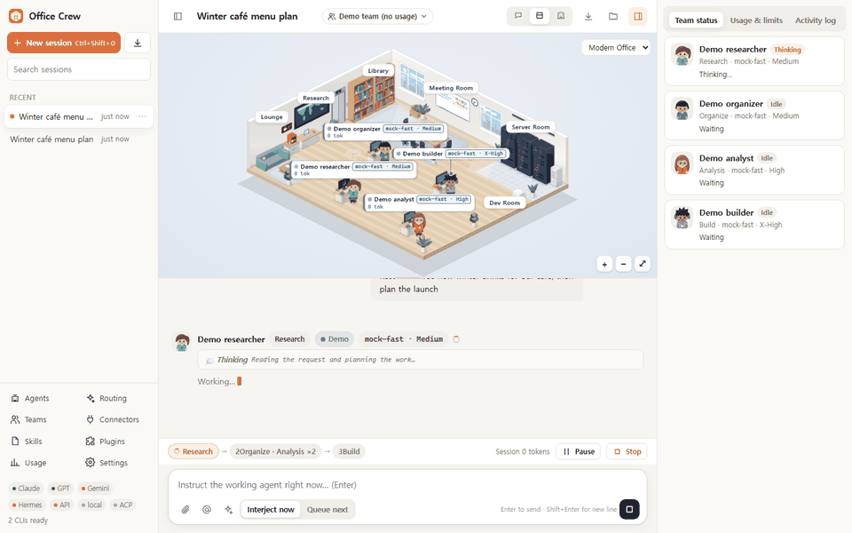
</p>

Office Crew is a local workspace for running several AI agents together. It runs the **official CLIs you have installed and signed in to** (Claude Code, OpenAI Codex CLI, Gemini CLI, Nous Hermes Agent) and any ACP-compatible agent, plus OpenAI-compatible APIs and local models. You arrange the agents into a pipeline, and while they work you can watch each one move around an office and step in at any point.

## 💡 Why Office Crew

- **Use the subscriptions you already have.** Office Crew launches the official CLIs on your machine with their existing sign-in. It never asks for or stores your passwords.
- **A team instead of a single chat box.** Each agent has its own model, effort level, permissions, skills and MCP connectors. Stages run in order, agents inside a stage run in parallel, and with auto-routing, reviews are cross-checked by a different AI than the one that did the build whenever possible.
- **See and steer every step.** Characters walk to the research room, the library or the server room depending on the tool they're using, raise a hand when they need approval and sweat when something fails. You can redirect or skip any agent mid-run, pause the run before its next stage, or stop it.
- **Light on resources.** Zero runtime dependencies, no build step, about 65 MB of RAM when idle. The server listens on `127.0.0.1` only.

## ✨ Features

### Agents and auto-routing

- **Per-agent routing:** provider, model, effort (low → max, plus xhigh where supported), permission (Read-only → Allow all), system prompt, skills, MCP connectors and avatar.
- **Live model catalogs:** model dropdowns come from each CLI's own model catalog where the CLI provides one. They refresh automatically every 30 minutes and whenever a CLI update is detected.
- **Auto-routing (default for new agents):** when a run starts, Office Crew picks a model and effort from the signed-in AIs it can route to (Claude Code, Codex, OpenAI-compatible APIs and local models, plus Gemini CLI for research). It decides by role (research, organize, analysis, build, review, writing) and profile (economy, balanced, best). Review agents are routed to a different AI than the builder whenever possible.
- **Routing board:** edit every agent's AI, model, effort and permission in one table.

| Agent editor | AI accounts and sign-in |
|---|---|
| 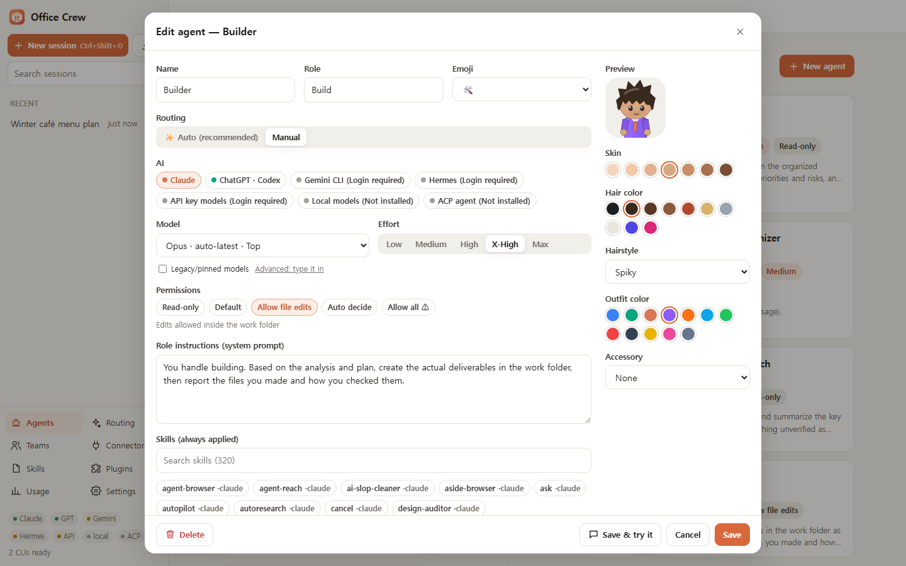 | 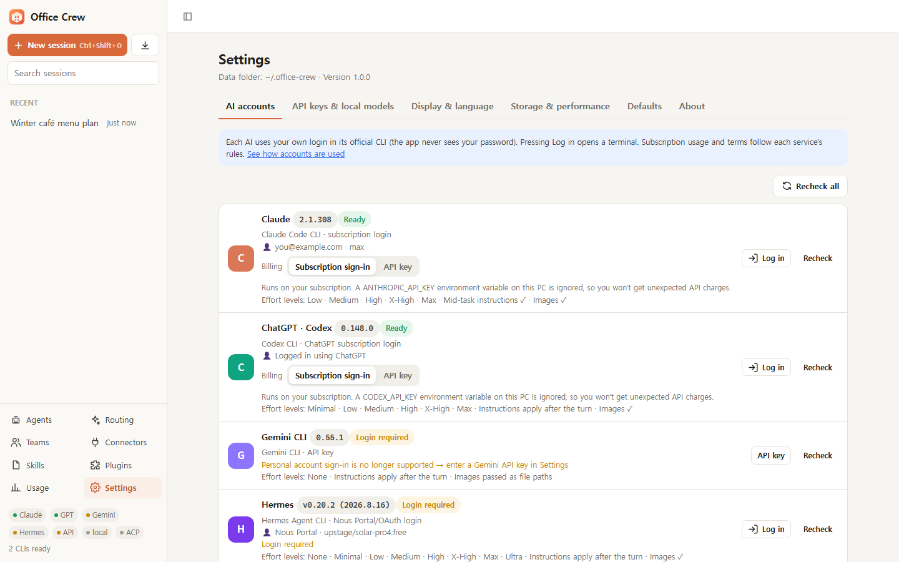 |
| Provider, model, effort, permission, skills and avatar for each agent | Each CLI's version, sign-in status and supported effort levels |

### Teams, approvals and live intervention

- **Pipelines:** stages run in order, agents in the same stage run in parallel, and each stage's output is handed to the next one automatically.
- **Approval gates:** a stage can wait for you. Approve it, or request changes, which reruns the stage with your feedback attached.
- **Error gate:** when an agent fails, choose retry, skip or stop.
- **Intervene while agents work:** steer a running agent (Claude receives the message inside the running process), queue a message for the next turn, pause and resume, stop, or skip a single agent.
- **Real-time usage:** tokens per message, agent and session (estimated while streaming, exact once the turn ends), cost when the CLI reports it, and account limits (Claude 5-hour and weekly %, Codex weekly %).

| Team editor | Approval gate |
|---|---|
| 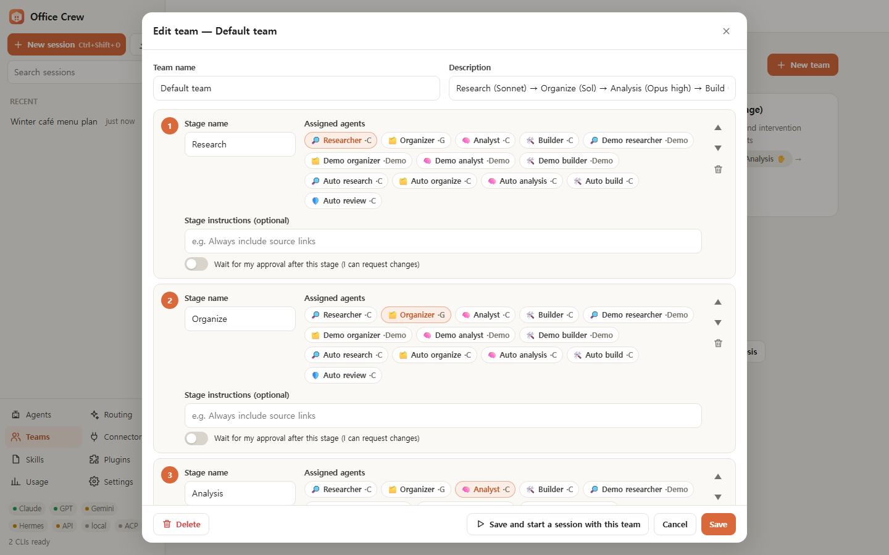 | 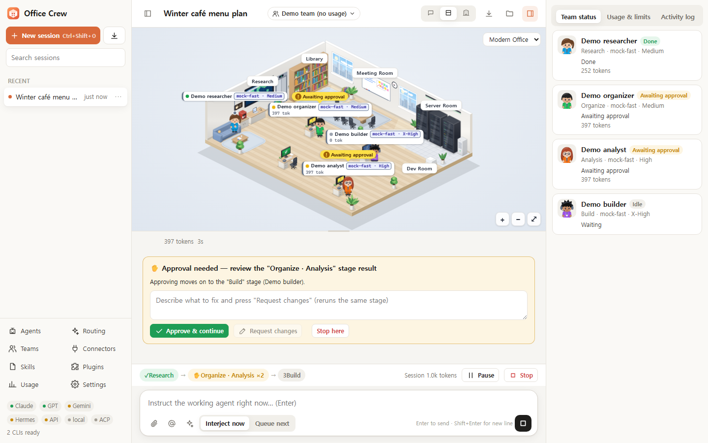 |
| Stages, assigned agents, per-stage instructions and approval toggles | Approve and continue, request changes, or stop here |

### Keeps working, connects to more

- **Automatic handoff:** when an AI hits its usage limit mid-task, another AI with headroom takes the same role and finishes from where it stopped. It receives the original request plus everything written so far. AIs that are resting, or above a usage threshold (95% by default), are avoided before a run starts. Turn it off, change the threshold or release a resting AI on the Routing board.
- **Billing per AI:** run Claude Code and Codex on your subscription or on an official API key (pay as you go). In subscription mode, a stray `ANTHROPIC_API_KEY` / `ANTHROPIC_AUTH_TOKEN` (Claude) or `CODEX_API_KEY` in your environment is ignored, so you aren't billed by surprise. In API key mode with no key entered in the app, your environment's key or gateway token is used as is.
- **ACP agents:** plug in any agent that speaks the [Agent Client Protocol](https://agentclientprotocol.com), such as Gemini CLI, Hermes, OpenCode, Goose or Qwen Code. Tool permission requests are answered by the agent's permission level. File reads and writes the agent asks Office Crew to do are limited to the work folder (reads also to attachments); the agent's own tools follow its own sandbox and your permission level.

| Routing board with automatic handoff | Import a Claude Code or Codex session |
|---|---|
| 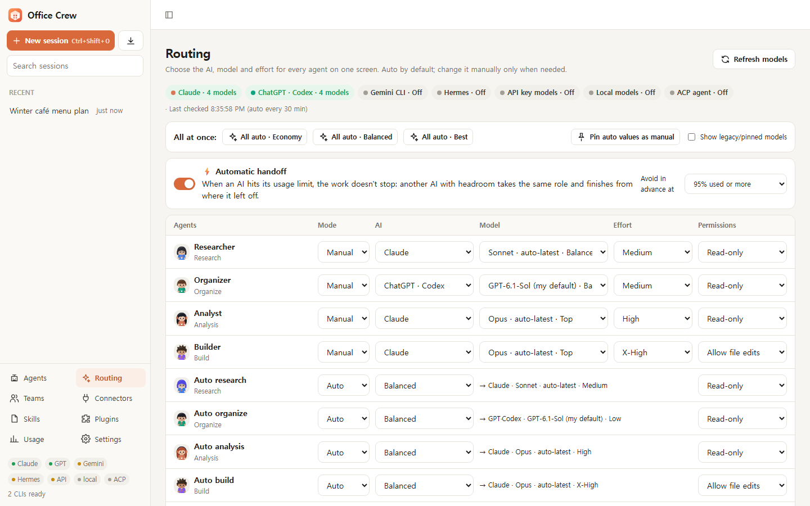 | 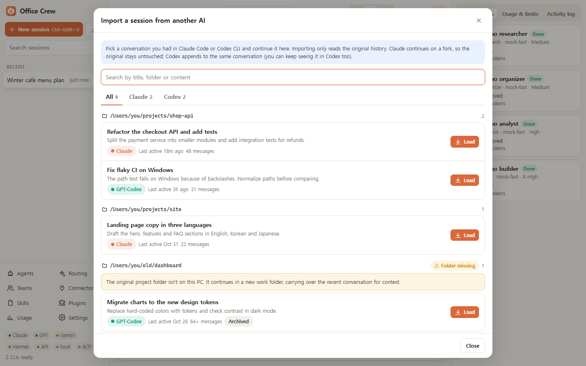 |
| Auto or manual per agent, handoff on usage limits | Pick a past conversation and keep going |

### The live office

- An isometric office drawn in plain SVG, with no game engine. Agents walk to the **Research** room, the **Library**, the **Server Room** or the **Meeting Room** depending on the tool they're using.
- Characters raise a hand when they need approval, sweat on errors, carry documents when handing work to the next stage, and sub-agent helpers appear when an agent delegates.
- **Skins:** Modern, Cozy and Night, or upload your own image and place desks and spots with the built-in editor.
- **Quality levels:** `full`, `lite` and `static` for low-end PCs.

| Status at a glance | Handoffs |
|---|---|
| 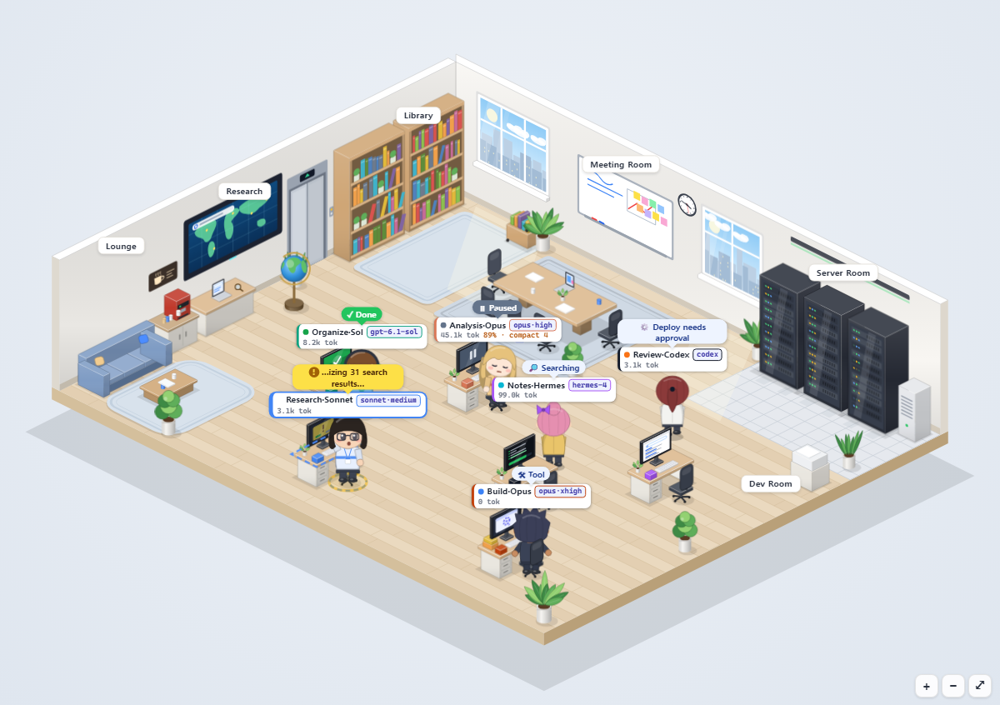 | 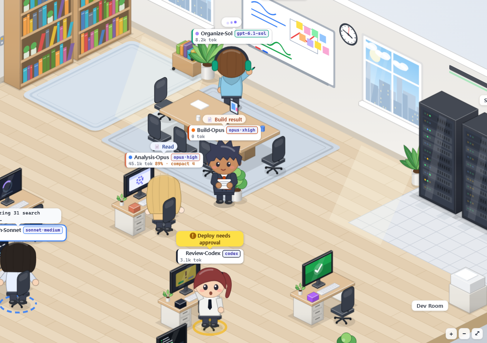 |
| Searching, using a tool, paused, done, needs approval | An agent carries its result to the next stage |
| **Modern skin** | **Cozy skin** |
| 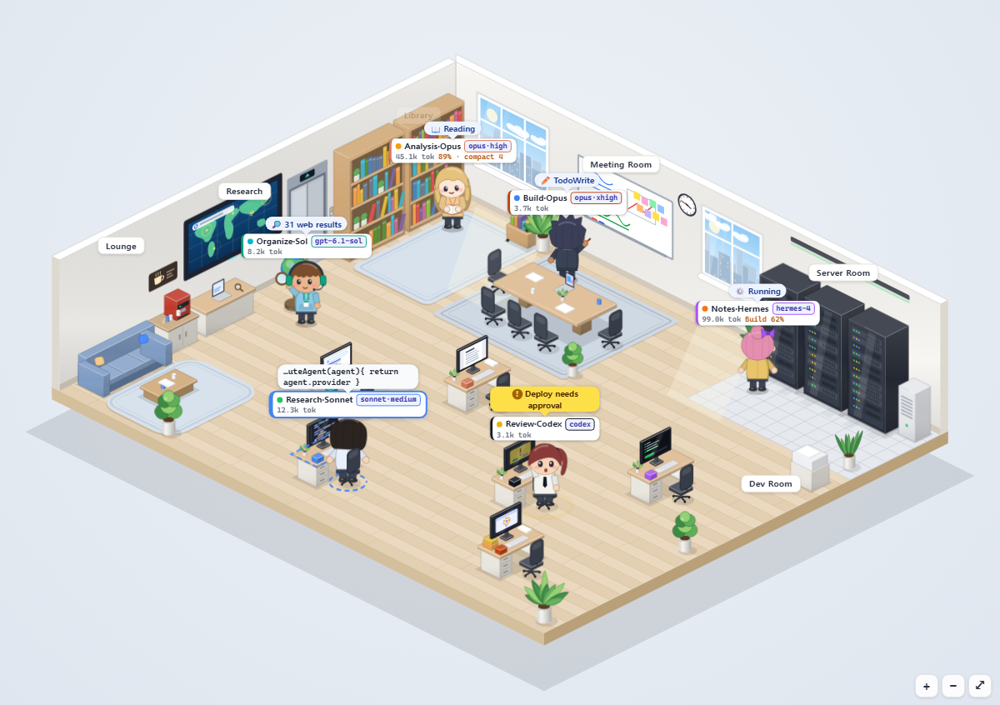 | 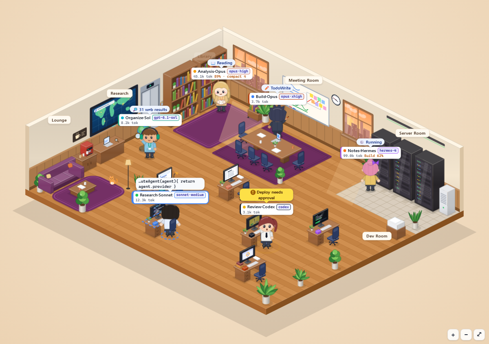 |
| **Night skin** | **Your own image as a skin** |
| 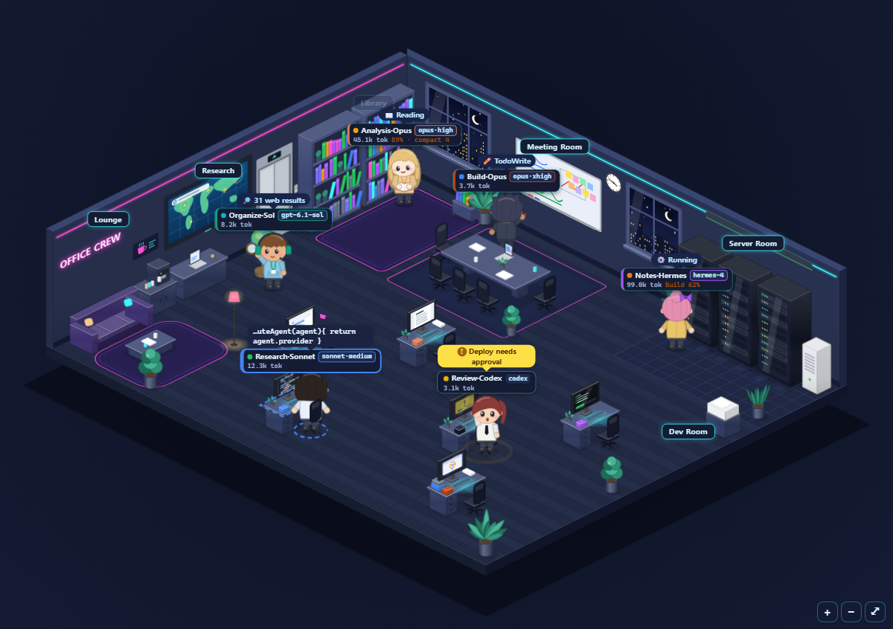 | 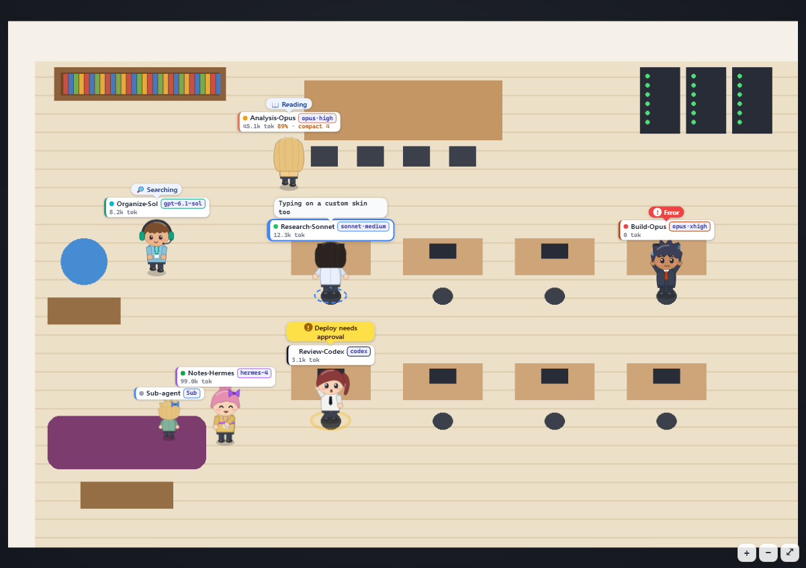 |

### Desktop-app comfort

- Sessions with search and pinning, image paste (Ctrl+V), drag and drop, `@agent` mentions, `/skill` commands.
- Markdown with copy buttons, resend and edit, export a chat to `.md`, dark mode.
- **Skills** are discovered automatically from your Claude and Codex skill folders. **MCP connectors** are injected per agent. **Plugins** bundle agents, teams, skills, connectors and skins into one JSON file you can import or export.
- **Import and continue** existing Claude Code and Codex sessions without losing context. Claude continues on a fork, so the original history stays untouched; if a session can't be resumed, the recent conversation is passed along instead.
- UI in Korean, English, Simplified Chinese and Japanese.

| Dark mode with the Night skin | Live usage while streaming |
|---|---|
| 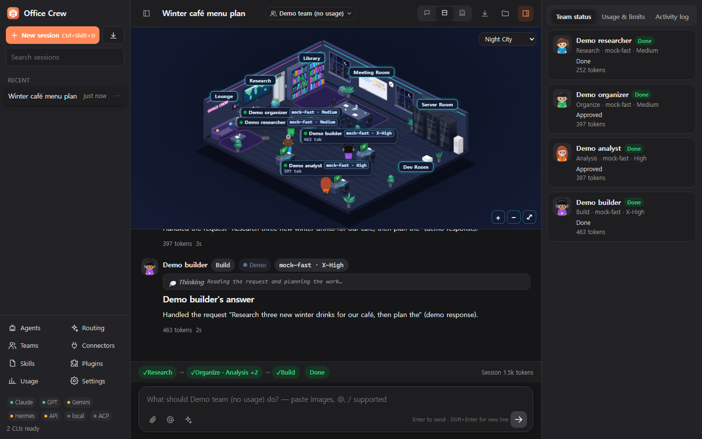 | 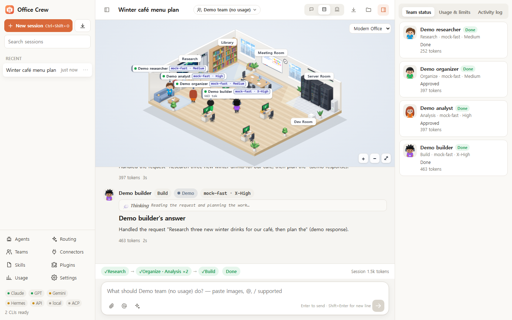 |
| Dark mode with a copyable code block | Token counts are estimated while streaming and replaced with real numbers at the end of the turn |

## 🚀 Quick start

**Requirements:** [Node.js](https://nodejs.org) 20 or newer, plus the AI CLIs you want to use. You don't need any of them to try the demo.

```bash
git clone https://github.com/yw8837/office-crew.git
cd office-crew
npm start
```

- The server starts at `http://127.0.0.1:4317` and opens an Edge/Chrome app window. If neither browser is found, it opens your default browser.
- **Windows:** you can also double-click `오피스크루 실행.cmd` ("Run Office Crew").
- **First run:** the built-in **Demo** team is selected by default. Its agents are simulated and use no AI quota, so you can try the office, approvals and steering before connecting any AI.
- Your data is stored in `~/.office-crew`.

| Option | Description |
|---|---|
| `--browser` | Open a normal browser tab instead of an app window |
| `--port <n>` | Server port (default `4317`) |
| `--home <dir>` | Data folder (default `~/.office-crew`) |
| `--no-open` | Start the server without opening a window |

Pass options after `--`, for example `npm start -- --browser --port 5000`. The environment variables `OFFICE_CREW_PORT` (or `PORT`) and `OFFICE_CREW_HOME` change the defaults too.

> `npx office-crew` is coming soon. The package isn't on npm yet.

## 🤖 Supported AIs

| AI | How it connects | Install | Sign in |
|---|---|---|---|
| **Claude Code** | Official CLI, your subscription or an Anthropic API key | `npm i -g @anthropic-ai/claude-code` | Settings → AI accounts → **Log in** (opens a terminal, then run `/login`) |
| **OpenAI Codex CLI** | Official CLI, your ChatGPT account or an OpenAI API key | Codex CLI | `codex login` |
| **Gemini CLI** | Official CLI + Gemini API key | `npm i -g @google/gemini-cli` | Settings → API keys & local models → Gemini CLI key |
| **Nous Hermes Agent** | Official CLI | Hermes Agent | `hermes model` |
| **ACP agents** | Agent Client Protocol over stdio | Gemini CLI, Hermes, OpenCode, Goose, Qwen Code and others | Settings → API keys & local models → ACP agents (one-click presets) |
| **OpenAI-compatible APIs** | HTTPS API | none | Settings → API keys & local models: OpenAI, OpenRouter, Nous Portal, xAI, Gemini API |
| **Local models** | Local HTTP server | Ollama, LM Studio, llama.cpp, vLLM or Jan | None. Detected automatically while the server runs; custom URLs can be added in Settings |
| **Demo** | Built in | none | None, 0 usage |

Settings → **AI accounts** shows each CLI's install status, version, signed-in account and supported effort levels.

## 🧭 How it works

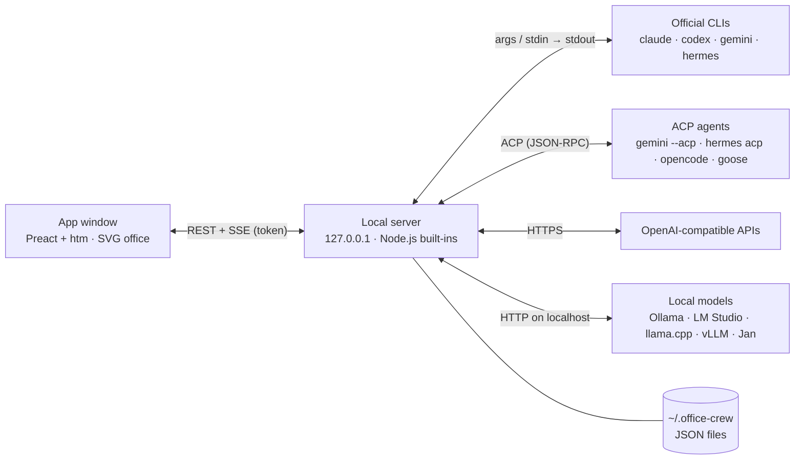

1. You send a message to an agent or a team.
2. The orchestrator runs the stages. Each agent is a CLI process or API call with its own model, effort, permission, skills and connectors.
3. Streamed output becomes chat messages, tool blocks, usage numbers and office animations over Server-Sent Events.
4. For CLIs that can resume (Claude Code, Codex), each agent's session ID is saved and the next turn continues the same conversation. For the others, recent messages are added to the prompt.

Design details and the provider adapter contract are in [docs/DESIGN.md](docs/DESIGN.md) (Korean).

## ⚖️ How it compares

These are broad categories, not specific products. Many good tools exist in each, so pick what fits your workflow.

| | **Office Crew** | Single-CLI GUIs | Visual workflow builders | Multi-model chat UIs |
|---|---|---|---|---|
| Runs your signed-in official CLIs | ✅ | One CLI | Usually API keys | Usually API keys |
| Mix vendors in one run | ✅ | Usually one vendor | Often | Varies |
| Staged teams with parallel agents | ✅ | Rarely | Core strength | Rarely |
| Approval gates and mid-run steering | ✅ | Varies | Varies | Limited |
| Per-agent model, effort and permission | ✅ | Per session | Per node | Per chat |
| Live view of what each agent is doing | ✅ Animated office | Terminal or log view | Node graph | Chat transcript |
| Local models | ✅ | Varies | Often | Often |
| Runtime dependencies | 0 | Varies | Varies | Varies |

## 📜 Using your accounts

Office Crew is built to stay inside each provider's rules. In short:

- **Official tools, unmodified.** Office Crew starts the CLIs you installed as separate processes, the same way you would from a terminal. It doesn't patch or impersonate them.
- **Your sign-in stays with the CLI.** Office Crew never reads, copies, stores or relays CLI sign-in tokens (such as `~/.claude/.credentials.json` or `~/.codex/auth.json`). From `~/.claude.json`, only the MCP server list is used. Signing in always happens in the vendor's own CLI, in a terminal window (Office Crew can open one for you).
- **One person, one computer.** A subscription sign-in is for your own use on your own machine. Don't share an account through Office Crew or offer it as a service to other people.
- **Products, teams and unattended runs use API keys.** If you build something for others, use it at work or run it unattended, switch Claude Code and Codex to **API key** billing (Settings → AI accounts → Billing). Anthropic asks third-party products not to offer claude.ai sign-in or subscription limits unless approved, and OpenAI recommends API keys for programmatic Codex use.
- **Google:** personal Google sign-in for Gemini CLI (Gemini Code Assist for individuals) no longer works, so Office Crew uses a Gemini API key. Antigravity isn't supported, because its personal-account terms don't allow use through third-party tools.
- **Hermes:** if you choose Anthropic as Hermes' provider, Hermes can reuse Claude Code's sign-in token. Give Hermes an Anthropic API key or another provider instead.
- Office Crew isn't affiliated with Anthropic, OpenAI, Google or Nous Research.

Terms change, and this summary isn't legal advice. Check each provider's current terms before relying on it.

## 🔒 Security and privacy

- **Local only.** The server binds to `127.0.0.1`, rejects requests whose `Host` or `Origin` isn't the app itself (which blocks DNS rebinding and cross-site calls), and requires a per-install token on every API call.
- **Safe rendering.** Agent output is escaped before markdown rendering, so HTML and scripts in a response never execute.
- **No passwords.** The CLIs keep their own sign-in. API keys are stored only in your data folder (`settings.json`) and shown masked (last 4 characters). Connector and ACP values whose names look secret (token, key, secret, password and similar) are masked the same way.
- **No telemetry.** The server's only outbound requests go to the API endpoints you configure and to local model servers. The CLIs talk to their own providers as they normally do.
- **Permissions matter.** "Allow all", and "Auto decide" for Gemini CLI and ACP agents, let an agent run commands without asking, so use them only in folders you trust.

Found a vulnerability? See [SECURITY.md](SECURITY.md).

## ❓ FAQ

**Is this allowed by the AI providers' terms?**
Office Crew doesn't sign in for you, proxy your account or share credentials. It starts the official CLI you installed and signed in to, on your own machine, the same way you would from a terminal. You're still responsible for following each service's terms, including any rules on automation or third-party tools. For organizational or commercial use, API keys are the safer route. See [Using your accounts](#-using-your-accounts) for the rules Office Crew follows. Office Crew isn't affiliated with Anthropic, OpenAI, Google or Nous Research.

**What does it cost?**
Office Crew itself is free under the AGPL. Each provider counts usage against your subscription or API key exactly as if you used its CLI directly. The usage panel shows tokens and account limits as you go, the **economy** routing profile picks cheaper models, and the demo provider costs nothing.

**Can I use it offline or with local models only?**
Yes. Ollama, LM Studio, llama.cpp, vLLM and Jan are detected automatically while they run, and the UI ships with its own copies of Preact and htm, so nothing loads from a CDN.

**Do I need every CLI?**
No. Install any subset. Auto-routing only considers AIs you're signed in to.

**Which operating systems are supported?**
Office Crew is developed on Windows, and CI runs the test suite on Windows, Linux and macOS (Node.js 20 and 22). The app window uses Edge or Chrome and falls back to your default browser.

## 🗺️ Roadmap

- [ ] npm release and `npx office-crew`
- [ ] More providers
- [ ] Team templates gallery
- [ ] Mobile companion

Ideas and votes are welcome in [Issues](https://github.com/yw8837/office-crew/issues).

## 🤝 Contributing

Bug reports, provider adapters, skins and translations are all welcome. Start with [CONTRIBUTING.md](CONTRIBUTING.md). The test suite uses fake CLIs, so `npm test` uses no AI quota.

```bash
npm test
```

Please follow the [Code of Conduct](CODE_OF_CONDUCT.md). Release notes are in [CHANGELOG.md](CHANGELOG.md).

## 📄 License

Office Crew is **dual-licensed**:

- [GNU AGPL-3.0-only](LICENSE) for personal use, study, research, internal tools and AGPL-compliant open source (free).
- A **commercial license** for closed-source products, hosted services that don't publish their modified source, or other terms. See [COMMERCIAL-LICENSE.md](COMMERCIAL-LICENSE.md).

Bundled third-party code (Preact, MIT; htm, Apache-2.0) is listed in [THIRD-PARTY-NOTICES.md](THIRD-PARTY-NOTICES.md). Product names are trademarks of their respective owners.

## ⭐ Star history

[](https://star-history.com/#yw8837/office-crew&Date)
