<div align="center">


# Office Crew（오피스 크루）

**把你已经在用的 AI CLI 组成一个团队，在实时的等距视角办公室里看着它们干活。**

[English](README.md) · [한국어](README.ko.md) · 简体中文 · [日本語](README.ja.md)

[](LICENSE)
[](https://nodejs.org)
[](package.json)
[](CONTRIBUTING.md)
[](#-常见问题)

</div>

<p align="center">
  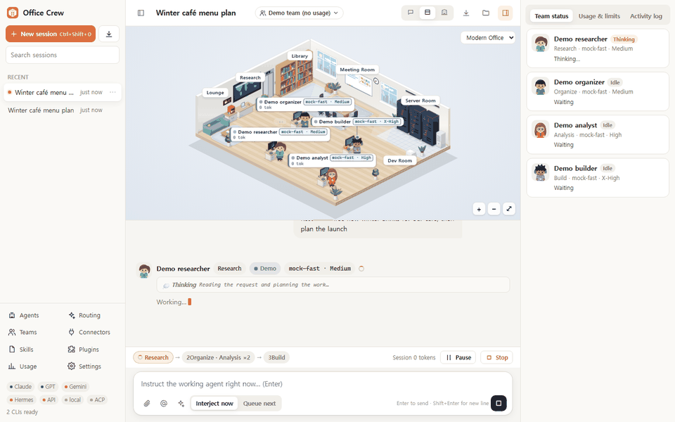
</p>

Office Crew 是一个在本地同时运行多个 AI 智能体的工作台。它直接调用你**已安装并登录的官方 CLI**（Claude Code、OpenAI Codex CLI、Gemini CLI、Nous Hermes Agent）以及任何 ACP 智能体，也支持 OpenAI 兼容 API 和本地模型。把智能体按阶段编排好之后，你可以看着每个智能体在办公室里走动，并随时介入。

## 💡 为什么选择 Office Crew

- **直接用你现有的订阅。** Office Crew 在你的电脑上以现有登录状态启动官方 CLI，不会索要或保存你的密码。
- **不只是一个聊天框，而是一个团队。** 每个智能体都有自己的模型、推理强度（effort）、权限、技能和 MCP 连接器。阶段按顺序执行，同一阶段内的智能体并行工作，使用自动路由时，审查环节会尽量交给与构建者不同的 AI 交叉检查。
- **每一步都看得见、改得了。** 角色会根据所用工具走到检索室、资料室或机房；需要审批时举手，出错时冒冷汗。运行中可以给智能体改指令或单独跳过某个智能体，也可以在下一阶段开始前暂停，或停止整个运行。
- **占用资源少。** 零运行时依赖，无需构建，空闲时内存约 65 MB。服务器只监听 `127.0.0.1`。

## ✨ 功能

### 智能体与自动路由

- **按智能体路由：** 每个智能体可单独设置服务商、模型、推理强度（low → max，支持的模型还有 xhigh）、权限（只读 → 全部允许）、系统提示词、技能、MCP 连接器和头像。
- **实时模型目录：** 只要 CLI 提供模型列表，下拉菜单就直接读取该 CLI 自己的目录；每 30 分钟以及检测到 CLI 更新时自动刷新。
- **自动路由（新建智能体的默认选项）：** 运行开始时，从可自动分配的已登录 AI（Claude Code、Codex、OpenAI 兼容 API、本地模型，调研角色还包括 Gemini CLI）中挑选模型和推理强度。依据是角色（调研、整理、分析、构建、审查、写作）和配置档（经济、均衡、最佳）。审查智能体会尽量分配给与构建者不同的 AI。
- **路由面板：** 在一张表里修改所有智能体的 AI、模型、推理强度和权限。

| 智能体编辑器 | AI 账号与登录 |
|---|---|
| 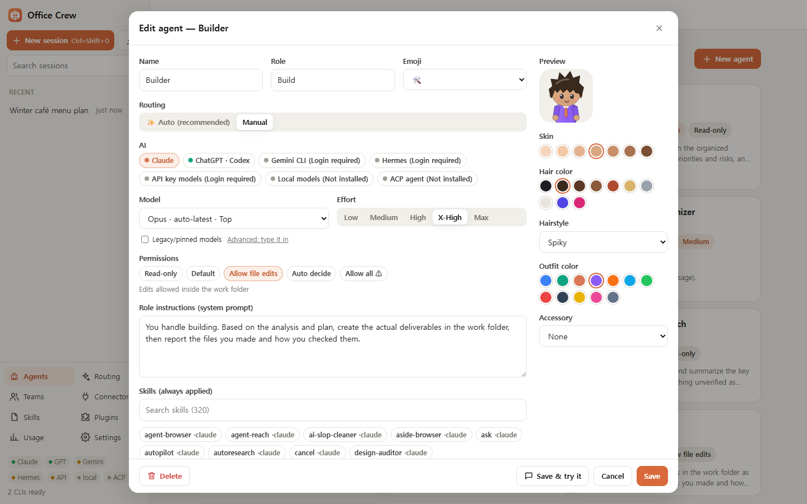 | 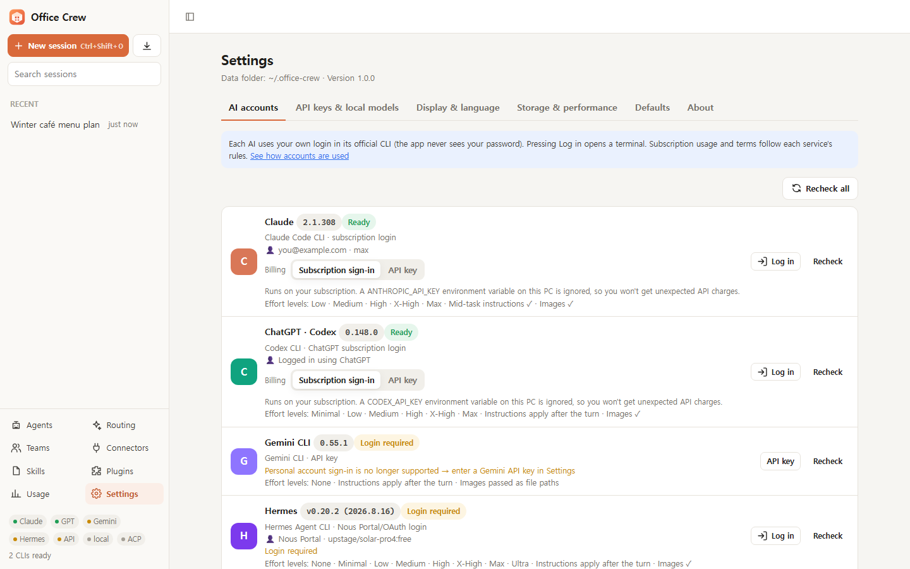 |
| 为每个智能体设置服务商、模型、推理强度、权限、技能和头像 | 每个 CLI 的版本、登录状态和支持的推理强度 |

### 团队、审批与实时介入

- **流水线：** 阶段按顺序执行，同一阶段的智能体并行工作，每个阶段的输出会自动交给下一阶段。
- **审批关卡：** 可以让某个阶段等待你的确认。你可以批准，也可以提出修改意见，系统会带着你的反馈重新运行该阶段。
- **错误关卡：** 智能体出错时，可选择重试、跳过或停止。
- **运行中介入：** 向正在运行的智能体发送指令（Claude 会直接注入到运行中的进程），把消息排到下一轮，暂停与恢复，停止，或只跳过某一个智能体。
- **实时用量：** 按消息、智能体、会话统计 token（流式输出时为估算值，回合结束后换成实际值），CLI 提供时显示费用，以及账号额度（Claude 5 小时与每周百分比、Codex 每周百分比）。
- **待处理：** 侧边栏顶部汇总需要你处理的会话（审批、出错后的决定、已暂停、失败，以及还没打开的结果），点一下就能直接进入。结果和失败打开后就会移出列表；审批、决定和暂停会一直保留到处理为止。
- **基于证据的审查：** 审查智能体会被要求只根据自己确认过的证据（文件、命令与测试输出）作出判定，并单独列出没能确认的项目。如果由做出结果的同一个 AI 来审查，会标明这比交叉验证弱。

| 团队编辑器 | 审批关卡 |
|---|---|
| 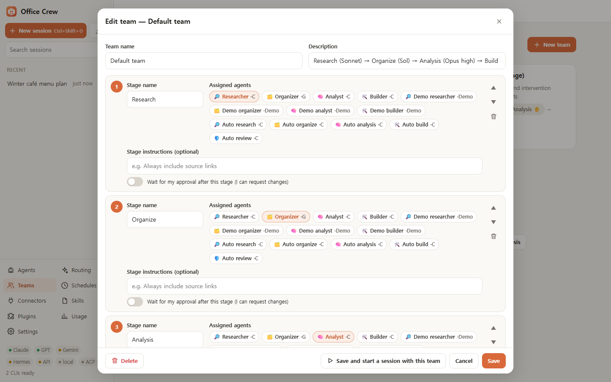 | 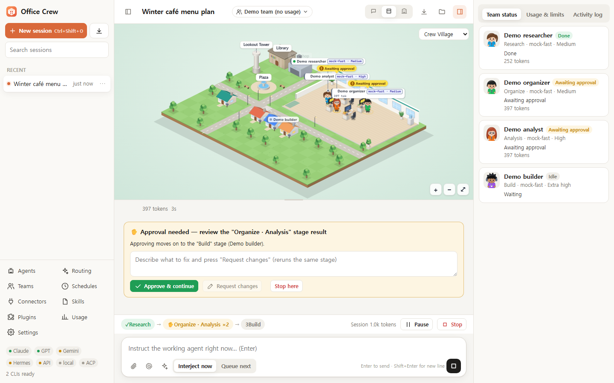 |
| 阶段、负责智能体、阶段指令和审批开关 | 批准并继续 / 要求修改 / 在此停止 |

### 不中断，连接更多

- **自动接力：** 某个 AI 在任务中途达到用量上限时，由仍有余量的其他 AI 以相同角色接手，从中断处继续完成。它会收到原始请求、到目前为止写好的全部内容，以及服务器从工具记录中提取的交接单（用过的工具、改动过的文件、最后的命令；命令只保留程序名、常见子命令和普通文件名，容易带有令牌、密码的其他参数会被去掉），并被要求先检查当前状态。达到上限的 CLI（Claude Code、Codex、Gemini CLI、Hermes）会休息到用量数据中的重置时间；没有该数据时，以错误信息里写明的时间为准（都没有时休息 30 分钟）。正在休息或用量超过阈值（默认 95%）的 AI 会在运行前提前避开。可以在路由面板中关闭、修改阈值，或立即解除某个 AI 的休息状态。
- **按 AI 选择计费方式：** Claude Code 和 Codex 可以使用你的订阅，也可以使用官方 API 密钥（按用量计费）。在订阅模式下会忽略电脑上的 `ANTHROPIC_API_KEY`、`ANTHROPIC_AUTH_TOKEN`（Claude）和 `CODEX_API_KEY` 环境变量，避免意外计费。API 密钥模式下若未在应用中填写密钥，则原样使用电脑环境变量中的密钥或网关令牌。
- **ACP 智能体：** 直接接入支持 [Agent Client Protocol](https://agentclientprotocol.com) 的智能体，例如 Gemini CLI、Hermes、OpenCode、Goose、Qwen Code。工具权限请求会按智能体的权限级别自动回复。智能体请 Office Crew 代为读写的文件仅限工作文件夹内（读取也可访问附件文件夹）；智能体自带的工具遵循其自身的沙箱和你设置的权限级别。

| 带自动接力的路由面板 | 导入 Claude Code 或 Codex 会话 |
|---|---|
| 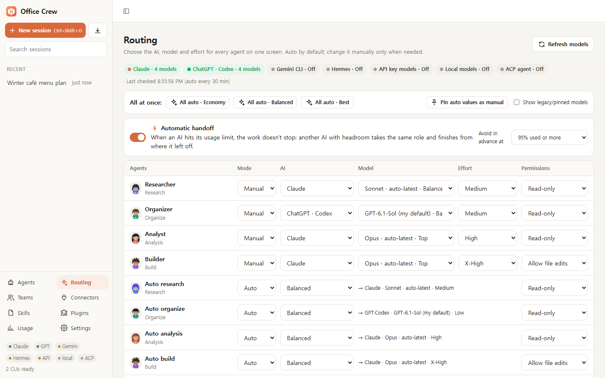 | 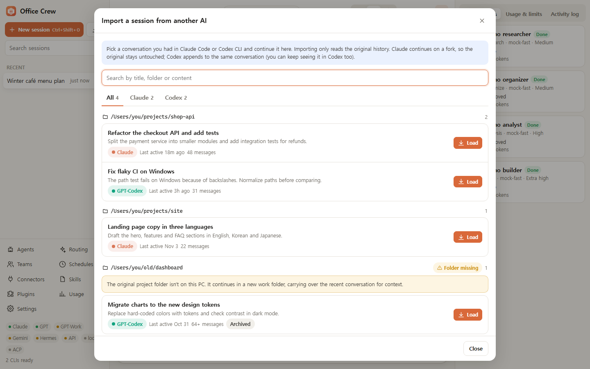 |
| 每个智能体可选自动或手动，达到上限时自动接力 | 选一段过去的对话继续做 |

### 实时办公室

- 用纯 SVG 绘制的等距视角办公室，不依赖游戏引擎。智能体会根据所用工具走到**检索室**、**资料室**、**机房**或**会议室**。
- 需要审批时举手，出错时冒冷汗，交接时抱着文件走向下一阶段；智能体分派任务时还会出现子智能体助手。
- **皮肤：** 内置现代、温馨、夜景三种；也可以上传自己的图片，在编辑器里摆放工位和走动点，做成自定义皮肤。
- **画质档位：** 为低配电脑提供 `full`、`lite`、`static` 三档。

| 状态一目了然 | 工作交接 |
|---|---|
| 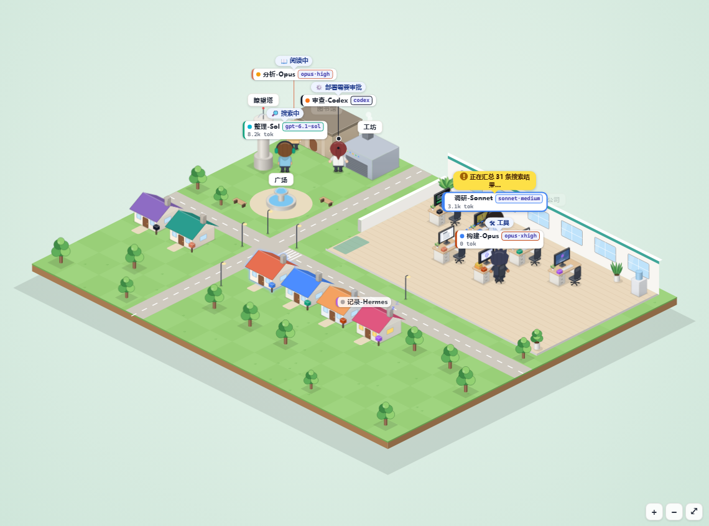 | 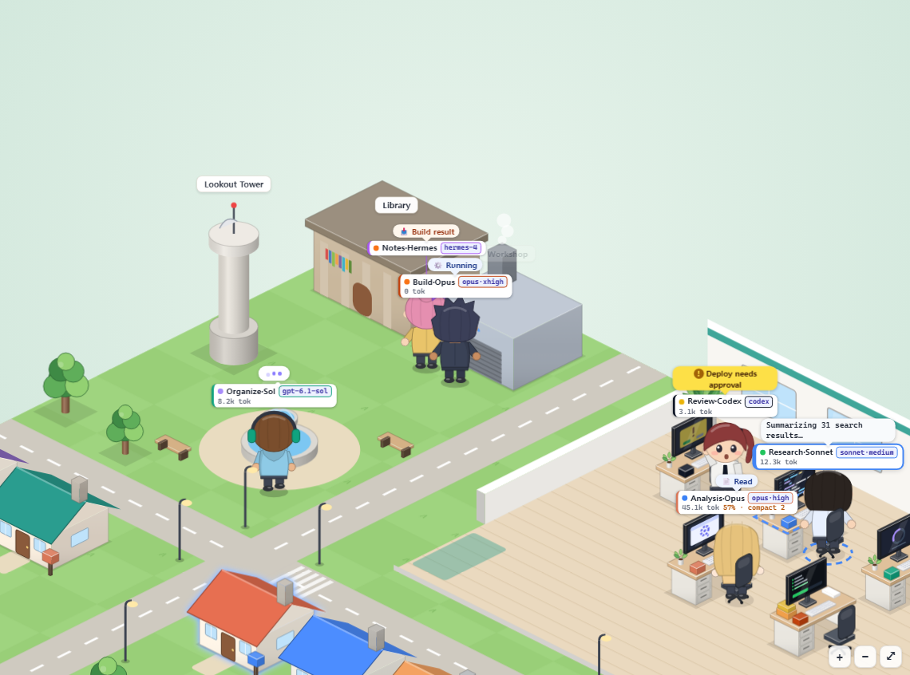 |
| 检索中、使用工具、暂停、完成、需要审批 | 智能体把结果送到下一阶段 |
| **现代皮肤** | **温馨皮肤** |
| 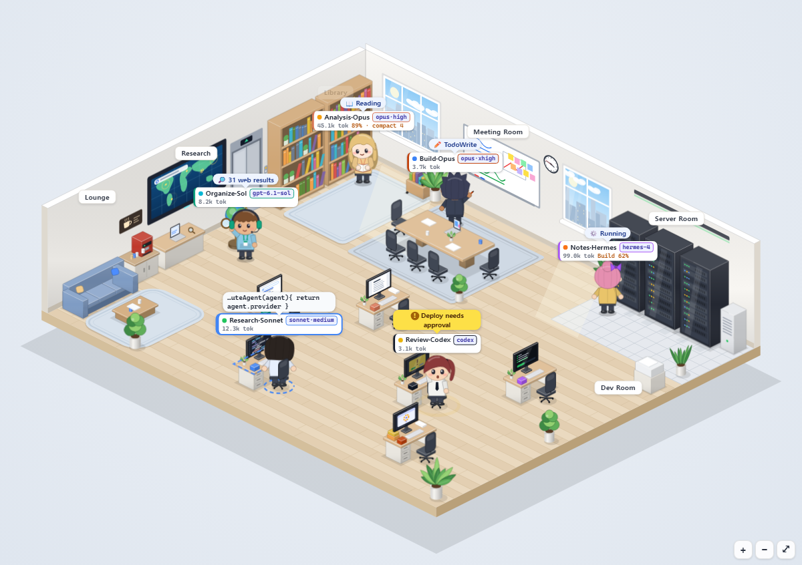 | 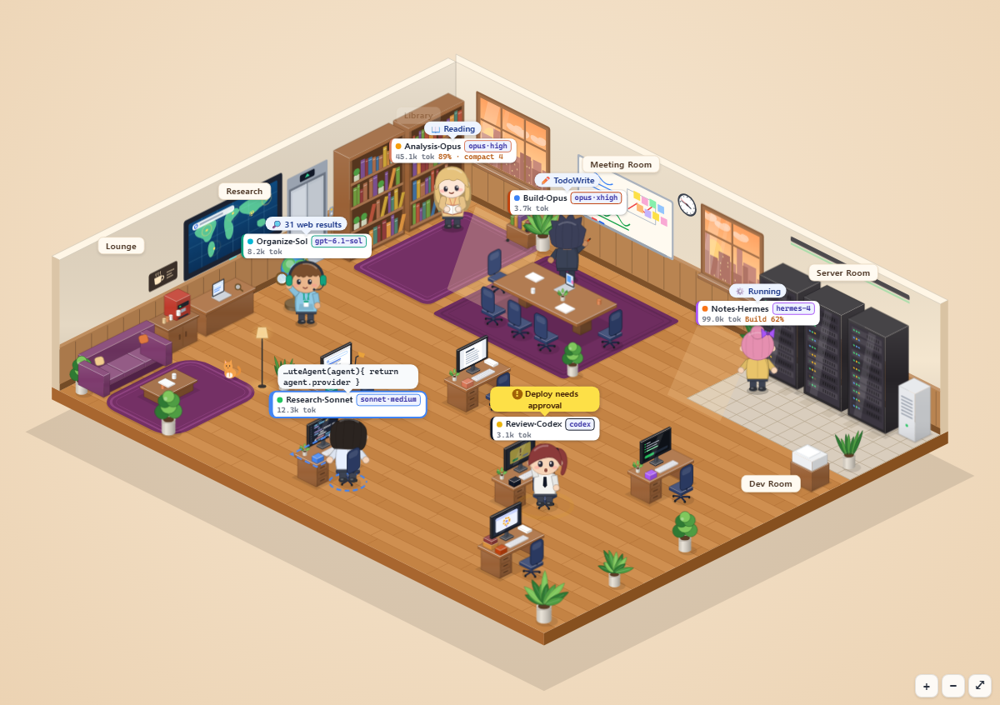 |
| **夜景皮肤** | **用自己的图片做皮肤** |
| 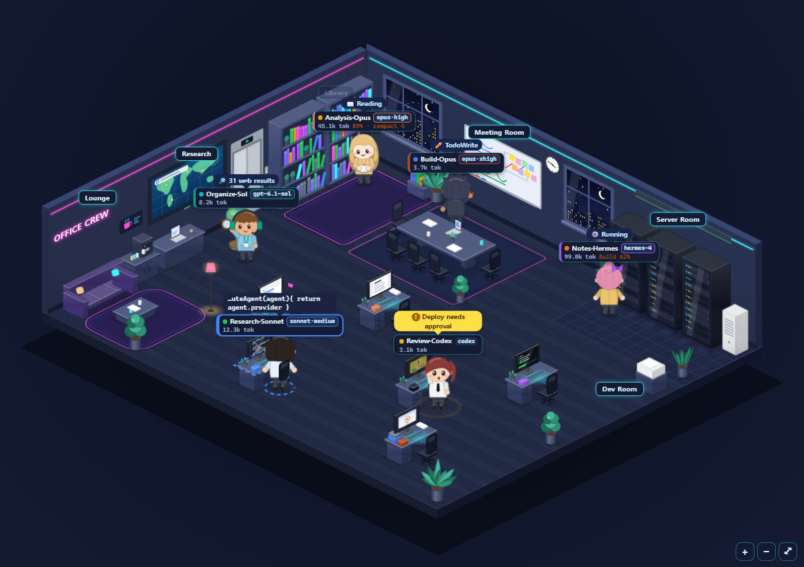 | 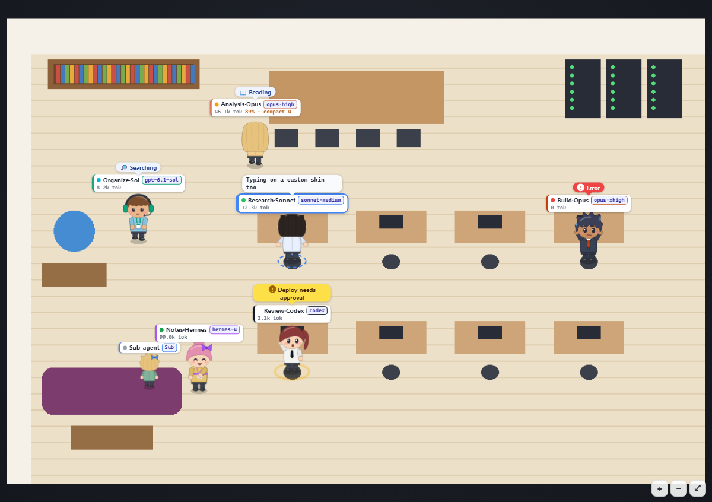 |

### 桌面应用般的体验

- 会话搜索与置顶、粘贴图片（Ctrl+V）、拖放、`@智能体` 提及、`/技能` 命令。
- 带复制按钮的 Markdown、重新发送与编辑、把对话导出为 `.md`、深色模式。
- **技能**会自动从 Claude 和 Codex 的技能文件夹中发现。**MCP 连接器**按智能体注入。**插件**把智能体、团队、技能、连接器和皮肤打包成一个 JSON 文件，可导入导出。
- **导入并继续**已有的 Claude Code 和 Codex 会话，不丢失上下文。Claude 以分支（fork）方式继续，原记录保持不变；无法续接的会话会带入最近的对话来保持上下文。
- 界面语言：韩语、英语、简体中文、日语。

| 深色模式 + 夜景皮肤 | 流式输出时的实时用量 |
|---|---|
| 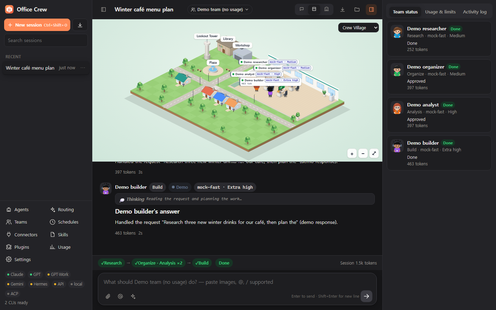 | 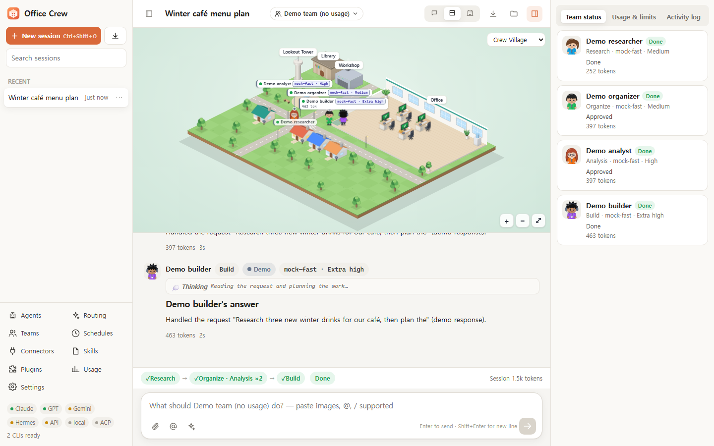 |
| 带可复制代码块的深色模式 | 输出时估算 token，回合结束后替换为实际数值 |

## 🚀 快速开始

**环境要求：** [Node.js](https://nodejs.org) 20 或更高版本，以及你想用的 AI CLI。只体验演示的话，一个 CLI 都不需要。

```bash
git clone https://github.com/yw8837/office-crew.git
cd office-crew
npm start
```

- 服务器在 `http://127.0.0.1:4317` 启动，并打开 Edge/Chrome 应用窗口；两者都找不到时，会用默认浏览器打开。
- **Windows：** 也可以直接双击 `오피스크루 실행.cmd`（"运行 Office Crew"）。
- **首次运行：** 默认选中内置的**演示**团队。演示智能体是模拟的，不消耗任何 AI 额度，可以在接入 AI 之前先体验办公室、审批和介入功能。
- 数据保存在 `~/.office-crew`。

| 选项 | 说明 |
|---|---|
| `--browser` | 用普通浏览器标签页代替应用窗口 |
| `--port <n>` | 服务器端口（默认 `4317`） |
| `--home <dir>` | 数据目录（默认 `~/.office-crew`） |
| `--no-open` | 只启动服务器，不打开窗口 |

选项写在 `--` 之后，例如 `npm start -- --browser --port 5000`。也可以用环境变量 `OFFICE_CREW_PORT`（或 `PORT`）和 `OFFICE_CREW_HOME` 修改默认值。

> `npx office-crew` 即将推出，目前还没有发布到 npm。

## 🤖 支持的 AI

| AI | 连接方式 | 安装 | 登录 |
|---|---|---|---|
| **Claude Code** | 官方 CLI，使用你的订阅或 Anthropic API 密钥 | `npm i -g @anthropic-ai/claude-code` | 设置 → AI 账号 → **登录**（打开终端后输入 `/login`） |
| **OpenAI Codex CLI** | 官方 CLI，使用你的 ChatGPT 账号或 OpenAI API 密钥 | Codex CLI | `codex login` |
| **Gemini CLI** | 官方 CLI + Gemini API 密钥 | `npm i -g @google/gemini-cli` | 设置 → API 密钥·本地模型 → Gemini CLI 密钥 |
| **Nous Hermes Agent** | 官方 CLI | Hermes Agent | `hermes model` |
| **ACP 智能体** | Agent Client Protocol（stdio） | Gemini CLI、Hermes、OpenCode、Goose、Qwen Code 等 | 设置 → API 密钥·本地模型 → ACP 智能体（预设按钮） |
| **OpenAI 兼容 API** | HTTPS API | 无 | 设置 → API 密钥·本地模型：OpenAI、OpenRouter、Nous Portal、xAI、Gemini API |
| **本地模型** | 本机 HTTP 服务 | Ollama、LM Studio、llama.cpp、vLLM 或 Jan | 无需登录。服务运行时自动检测，其他地址可在设置中添加 |
| **演示** | 内置 | 无 | 无需登录，用量为 0 |

在设置 → **AI 账号**中可以查看每个 CLI 的安装状态、版本、登录账号和支持的推理强度。

## 🧭 工作原理

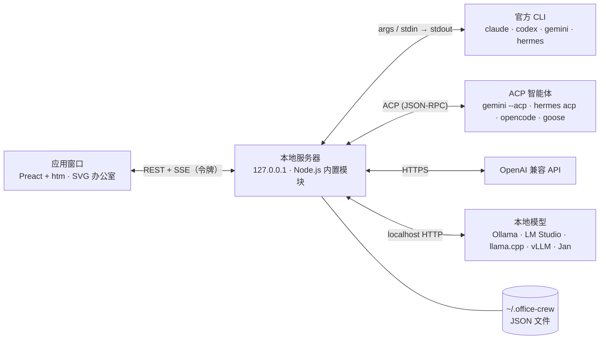

1. 你向某个智能体或团队发送消息。
2. 编排器依次推进各阶段。每个智能体都是一个 CLI 进程或一次 API 调用，带着自己的模型、推理强度、权限、技能和连接器。
3. 流式输出通过 Server-Sent Events（SSE）变成聊天消息、工具块、用量数据和办公室动画。
4. 对于支持续接的 CLI（Claude Code、Codex），会保存每个智能体的会话 ID，下一轮接着同一段对话继续；其他 CLI 则把最近的对话加入提示词来保持上下文。

详细设计和服务商适配器约定见 [docs/DESIGN.md](docs/DESIGN.md)（韩文）。

## ⚖️ 对比

下表比较的是常见的工具类型，而不是具体产品。每类都有很多优秀的工具，请按自己的工作方式选择。

| | **Office Crew** | 单一 CLI 的图形界面 | 可视化工作流编排工具 | 多模型聊天界面 |
|---|---|---|---|---|
| 运行已登录的官方 CLI | ✅ | 仅一个 CLI | 多用 API 密钥 | 多用 API 密钥 |
| 一次运行中混用多家 AI | ✅ | 通常只有一家 | 经常支持 | 因工具而异 |
| 分阶段团队 + 并行智能体 | ✅ | 少见 | 核心能力 | 少见 |
| 审批关卡与运行中调整 | ✅ | 因工具而异 | 因工具而异 | 有限 |
| 按智能体设置模型、推理强度、权限 | ✅ | 按会话 | 按节点 | 按对话 |
| 实时查看每个智能体在做什么 | ✅ 动画办公室 | 终端或日志视图 | 节点图 | 聊天记录 |
| 本地模型 | ✅ | 因工具而异 | 经常支持 | 经常支持 |
| 运行时依赖 | 0 | 因工具而异 | 因工具而异 | 因工具而异 |

## 📜 账号使用原则

Office Crew 的设计目标是在各服务商的规则范围内使用。简而言之：

- **只用未经修改的官方工具。** Office Crew 只是把你安装的 CLI 作为独立进程启动，和你在终端里手动运行一样。它不会修改或冒充这些 CLI。
- **登录信息留在 CLI 里。** Office Crew 从不读取、复制、保存或转发 CLI 的登录令牌（例如 `~/.claude/.credentials.json`、`~/.codex/auth.json`）。从 `~/.claude.json` 中只使用 MCP 服务器列表。登录始终在终端窗口里通过各厂商的 CLI 完成（Office Crew 可以帮你打开终端）。
- **一人一机。** 订阅登录仅供你本人在自己的电脑上使用。不要通过 Office Crew 共享账号，也不要把它作为服务提供给他人。
- **产品、团队和无人值守运行请用 API 密钥。** 如果你要为他人构建产品、在公司中使用或无人值守运行，请把 Claude Code 和 Codex 的计费方式切换为 **API 密钥**（设置 → AI 账号 → 计费方式）。Anthropic 要求第三方产品在未获批准时不得提供 claude.ai 登录或订阅额度，OpenAI 也建议以编程方式使用 Codex 时采用 API 密钥。
- **Google：** Gemini CLI 的个人 Google 登录（Gemini Code Assist for individuals）已无法使用，因此 Office Crew 使用 Gemini API 密钥。Antigravity 的个人账号条款不允许通过第三方工具使用，因此不予支持。
- **Hermes：** 如果把 Hermes 的服务商设为 Anthropic，Hermes 可能会复用 Claude Code 的登录令牌。请改为给 Hermes 配置 Anthropic API 密钥或其他服务商。
- Office Crew 与 Anthropic、OpenAI、Google、Nous Research 没有任何关联。

条款可能会变化，本摘要也不构成法律建议。使用前请查看各服务商的最新条款。

## 🔒 安全与隐私

- **仅限本机。** 服务器只绑定 `127.0.0.1`，拒绝 `Host` 或 `Origin` 不是应用本身的请求（防止 DNS 重绑定和跨站调用），并且每个 API 调用都需要按安装生成的令牌。
- **安全渲染。** 智能体的输出先转义再渲染为 Markdown，回复中的 HTML 和脚本不会被执行。
- **不经手密码。** 登录状态由各 CLI 自己管理。API 密钥只保存在数据目录（`settings.json`）中，界面上只显示最后 4 位。连接器和 ACP 设置中名称看起来像机密的值（token、key、secret、password 等）也会同样遮盖。
- **无遥测。** 服务器对外的请求只会发往你配置的 API 地址和本机的本地模型服务。各 CLI 照常与各自的服务通信。
- **注意权限。** "全部允许"，以及 Gemini CLI 和 ACP 智能体的"自动判断"，会让智能体不经确认就执行命令，请只在可信的文件夹中使用。

发现漏洞？请参阅 [SECURITY.md](SECURITY.md)。

## ❓ 常见问题

**这样用符合 AI 服务商的条款吗？**
Office Crew 不会替你登录、代理你的账号或共享凭据。它只是在你自己的电脑上启动你已安装并登录的官方 CLI，和你在终端里手动运行一样。遵守各服务的条款（包括关于自动化或第三方工具的规定）仍是你自己的责任。用于组织或商业场景时，更推荐使用 API 密钥。Office Crew 遵守的原则见[账号使用原则](#-账号使用原则)。Office Crew 与 Anthropic、OpenAI、Google、Nous Research 没有任何关联。

**要花多少钱？**
Office Crew 本身依据 AGPL 免费使用。用量由各服务商从你的订阅或 API 密钥中扣除，和你直接使用其 CLI 完全一样。用量面板会实时显示 token 和账号额度；把路由配置档设为**经济**会选择更便宜的模型；演示服务商不产生任何费用。

**可以离线或只用本地模型吗？**
可以。Ollama、LM Studio、llama.cpp、vLLM 和 Jan 运行时会被自动检测。界面所用的 Preact 和 htm 也已随仓库附带，不会从 CDN 加载任何内容。

**需要安装所有 CLI 吗？**
不需要，装你需要的就行。自动路由只会考虑你已登录的 AI。

**支持哪些操作系统？**
Office Crew 在 Windows 上开发，CI 会在 Windows、Linux 和 macOS（Node.js 20 与 22）上运行测试。应用窗口使用 Edge 或 Chrome，找不到时改用默认浏览器。

## 🗺️ 路线图

- [ ] 发布到 npm，支持 `npx office-crew`
- [ ] 支持更多服务商
- [ ] 团队模板库
- [ ] 移动端配套应用

欢迎在 [Issues](https://github.com/yw8837/office-crew/issues) 中提出想法和投票。

## 🤝 参与贡献

欢迎提交缺陷报告、服务商适配器、皮肤和翻译。请先阅读 [CONTRIBUTING.md](CONTRIBUTING.md)。测试使用模拟 CLI，所以 `npm test` 不会消耗任何 AI 额度。

```bash
npm test
```

请遵守[行为准则](CODE_OF_CONDUCT.md)。更新记录见 [CHANGELOG.md](CHANGELOG.md)。

## 📄 许可证

Office Crew 采用**双重许可**：

- [GNU AGPL-3.0-only](LICENSE)：个人使用、学习、研究、内部工具，以及遵守 AGPL 的开源项目（免费）。
- **商业许可**：闭源产品、不公开修改源码的托管服务，或其他需要不同条款的场景。详见 [COMMERCIAL-LICENSE.md](COMMERCIAL-LICENSE.md)。

随附的第三方代码（Preact：MIT；htm：Apache-2.0）列在 [THIRD-PARTY-NOTICES.md](THIRD-PARTY-NOTICES.md) 中。各产品名称均为其各自所有者的商标。

## ⭐ Star 趋势

[](https://star-history.com/#yw8837/office-crew&Date)
